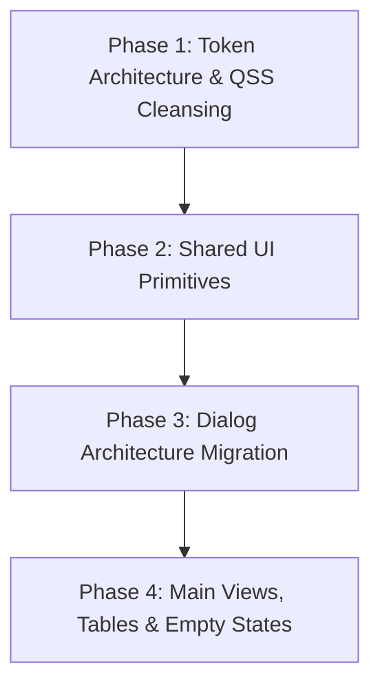

# Enterprise Design System & UI Consistency Audit

**Document ID:** `PLAN-2026-10-18-ENTERPRISE-DESIGN-SYSTEM-AUDIT`  
**Date:** 2026-10-18  
**Scope:** Full Codebase UI/UX Discovery & Architectural Audit (READ-ONLY)  
**Target System:** CloudBank POS (CB-POS) — PyQt6 Desktop Enterprise Point of Sale  
**Status:** COMPLETED & VERIFIED  

---

## 1. Executive Summary & Health Metrics

### 1.1 Executive Overview
This audit presents an exhaustive, forensic architectural inspection of the UI, styling mechanisms, widget ergonomics, and design system adherence across the entire CloudBank POS (CB-POS) desktop application codebase.

While CB-POS possesses robust backend domain logic and solid hardware integrations, its frontend styling is suffering from **severe architectural fragmentation**. The codebase currently exhibits an unstable collision of three distinct design systems (VSCode Cyberpunk Dark, Bootstrap 5 Light, and Tailwind CSS Slate), resulting in over **489 unique hardcoded hex colors**, **58 inline `setStyleSheet()` calls**, **277 inconsistently styled `QPushButton` instances**, and **55 modal dialogs** that implement arbitrary sizing, broken scroll responsiveness, and inverted button hierarchies.

Most critically, a severe semantic defect in `cbpos/ui/styles/dark.qss` (line 540) maps `QPushButton#BtnCancel` to the exact same style as destructive actions (`QPushButton[class="danger"]`), causing neutral dismiss actions across 24 dialogs to be painted in alarming **Danger Red (`#FF4136`)**.

### 1.2 Enterprise UI Health Metrics Dashboard

| Metric Category | Observed Count / Metric | Target Enterprise Standard | Health Status |
| :--- | :--- | :--- | :--- |
| **Total QDialog Subclasses Audited** | **55 Dialogs** | Unified `BaseModalDialog` | ⚠️ **Severe Fragmentation** |
| — Standardized via `make_dialog_footer` | 12 / 55 (21.8%) | 100% | ❌ Low Adoption |
| — Inverted `[Cancel] [Primary]` Button Order | 11 / 55 (20.0%) | 0% (Standardized `[Primary] [Cancel]`) | ❌ Cognitive Disruption |
| — Arbitrary Hand-Rolled Footers | 32 / 55 (58.2%) | 0% | ❌ Code Duplication |
| — Dialogs with `QScrollArea` Protection | **3 / 55 (5.5%)** | 100% of Form Dialogs | 🚨 **Critical POS Risk (Clipping)** |
| — Dialogs with Rigid `setFixedSize()` | 16 / 55 (29.1%) | 0% (Responsive Min-Sizes Only) | ❌ Broken on Small POS Screens |
| **Total QPushButton Instances Audited** | **277 Buttons** | 5 Unified Button Variants | ⚠️ **Severe Drift** |
| — Neutral Cancel Buttons Styled as Danger Red | **24 Dialogs / Widgets** | 0% (Cancel = Neutral Secondary) | 🚨 **Critical UX Defect** |
| — Conflicting Button Styling Systems | **8 Distinct Paradigms** | 1 Token-Driven Variant System | ❌ Architectural Debt |
| **Inline `.setStyleSheet()` Theme Leaks** | **58 Total (34 in `cbpos/ui`)** | **0 Calls** (100% Centralized QSS) | 🚨 **High Theme Switching Risk** |
| **Color Token Sprawl (Unique Hex Codes)** | **489 Unique Colors** | **≤ 24 Canonical Design Tokens** | 🚨 **Extreme Sprawl (20x bloat)** |
| — Unique Colors in `dark.qss` | 197 unique hexes (1,135 refs) | 16 canonical tokens | ❌ High Redundancy |
| — Unique Colors in `light.qss` | 177 unique hexes (1,178 refs) | 16 canonical tokens | ❌ High Redundancy |
| — Hardcoded Hexes in Python (`.py`) Files | 255 unique hexes (741 refs) | 0 (tokens imported from constants) | 🚨 Direct Theme Leakage |
| **Form Controls & Inputs Audited** | **299 Controls** | Unified Height & Padding Scale | ⚠️ **Visual Inconsistency** |
| — "Box-Inside-A-Box" Clutter (`QGroupBox`) | 22 instances | Flat Form Sections / `FormCard` | ❌ Visual Noise |
| — Height Fragmentation (Inputs & Buttons) | 26px, 32px, 38px, 44px, 48px, 56px | 32px (Compact), 36px (Standard), 44px (Touch) | ❌ Inconsistent Visual Rhythm |
| **Data Tables Audited (`QTableWidget` / `View`)** | **46 Tables** | Unified Data Grid Architecture | ⚠️ **High Drift** |
| — Tables Lacking Empty States (Black Voids) | **36 / 46 (78.3%)** | 0% (All Tables have `EmptyStateWidget`) | 🚨 **Poor User Feedback** |
| — Tables Lacking Column Configuration | 32 / 46 (69.6%) | 0% (All use `configure_table_columns`) | ❌ Truncation & Stretching |
| — Tables Lacking Numeric Header Alignment | 29 / 46 (63.0%) | 0% (All use `align_numeric_headers`) | ❌ Misaligned Numbers |
| — Tables Lacking `StatusPillDelegate` | 41 / 46 (89.1%) | 0% (All status columns use Delegate) | ❌ Ad-hoc String / Badge Rendering |

---

## 2. Button Semantic & Visual Drift Matrix (`QPushButton` & `QDialogButtonBox`)

### 2.1 The Semantic Inversion & Danger Red Defect
The most glaring styling flaw in CB-POS is the semantic mapping of `QPushButton#BtnCancel` in `cbpos/ui/styles/dark.qss` (line 540) and `light.qss` (line 541):
```css
/* Dark Mode — dark.qss:540 */
QPushButton#BtnCancel, QPushButton#VoidBtn, QPushButton[class="danger"] {
    background-color: #FF4136; /* Alarming Red */
    color: #FFFFFF;
    border: none;
}
```
Because `make_dialog_footer` specifies `cancel_object_name="BtnCancel"` by default, **every dialog that uses the shared footer automatically turns its harmless 'Cancel' button into an aggressive, blood-red destructive button**. Furthermore, developers noticed this visual clash in specific dialogs and added ad-hoc QSS overrides (e.g. `CustomerSelectionDialog QPushButton#BtnCancel` in `dark.qss:1660` overriding it to `#2D2D32`, and `DiscountDialog QPushButton#BtnCancel` in `dark.qss:2343` overriding it to transparent with red border), rather than fixing the root cause.

### 2.2 Button Inventory by Semantic Intent

#### 2.2.1 Primary / Confirm Actions (62 Audited Buttons)
*Actions that commit changes, confirm financial transactions, save records, or navigate forward.*

| Exact Label / Key | File Path & Line | Current Styling Mechanism | Computed Visual Appearance | Inconsistency Flag |
| :--- | :--- | :--- | :--- | :--- |
| `adjust_balance.mode_add` | [`cbpos/ui/dialogs/adjust_balance_dialog.py:119`](file:////Users/akash/Documents/CB-POS/cbpos/ui/dialogs/adjust_balance_dialog.py#L119) | id: `#ModeAddBtn` | Default Gray (#3E3E42 Dark / #FFF Light), text: #FFF Dark / #212529 Light, border: 1px solid #555555 Dark / #CED4DA Light, h: Auto (min 32px) | Consistent |
| `adjust_balance.confirm` | [`cbpos/ui/dialogs/adjust_balance_dialog.py:203`](file:////Users/akash/Documents/CB-POS/cbpos/ui/dialogs/adjust_balance_dialog.py#L203) | `class="accent"` | Vibrant Cyan (#00BCEB Dark / #00BCEB Light), text: #001F3F Dark / #FFFFFF Light, border: none, h: Auto (min 32px) | Uses Cyan Accent instead of canonical Green Primary |
| `adjust_points.mode_add` | [`cbpos/ui/dialogs/adjust_points_dialog.py:109`](file:////Users/akash/Documents/CB-POS/cbpos/ui/dialogs/adjust_points_dialog.py#L109) | id: `#ModeAddPtsBtn` | Default Gray (#3E3E42 Dark / #FFF Light), text: #FFF Dark / #212529 Light, border: 1px solid #555555 Dark / #CED4DA Light, h: Auto (min 32px) | Consistent |
| `adjust_points.confirm` | [`cbpos/ui/dialogs/adjust_points_dialog.py:212`](file:////Users/akash/Documents/CB-POS/cbpos/ui/dialogs/adjust_points_dialog.py#L212) | `class="accent"` | Vibrant Cyan (#00BCEB Dark / #00BCEB Light), text: #001F3F Dark / #FFFFFF Light, border: none, h: Auto (min 32px) | Uses Cyan Accent instead of canonical Green Primary |
| `` | [`cbpos/ui/dialogs/advanced_search_dialog.py:137`](file:////Users/akash/Documents/CB-POS/cbpos/ui/dialogs/advanced_search_dialog.py#L137) | id: `#BtnSearchSelect` | Vibrant Cyan (#00BCEB Dark / #00BCEB Light), text: #001F3F Dark / #FFFFFF Light, border: none, h: Auto (min 32px) | Uses Cyan Accent instead of canonical Green Primary |
| `btn_save` | [`cbpos/ui/dialogs/backup_password_dialog.py:88`](file:////Users/akash/Documents/CB-POS/cbpos/ui/dialogs/backup_password_dialog.py#L88) | `class="primary"` | Emerald Green (#2ECC40 Dark / #198754 Light), text: #001F3F Dark / #FFFFFF Light, border: none, h: Auto (min 32px) | Consistent |
| `common.save` | [`cbpos/ui/dialogs/cash_movement_dialog.py:65`](file:////Users/akash/Documents/CB-POS/cbpos/ui/dialogs/cash_movement_dialog.py#L65) | `class="accent"` | Vibrant Cyan (#00BCEB Dark / #00BCEB Light), text: #001F3F Dark / #FFFFFF Light, border: none, h: Auto (min 32px) | Uses Cyan Accent instead of canonical Green Primary |
| `category_manager.save_new` | [`cbpos/ui/dialogs/category_manager.py:123`](file:////Users/akash/Documents/CB-POS/cbpos/ui/dialogs/category_manager.py#L123) | `class="primary"` | Emerald Green (#2ECC40 Dark / #198754 Light), text: #001F3F Dark / #FFFFFF Light, border: none, h: Auto (min 32px) | Consistent |
| `category_tree.add_root` | [`cbpos/ui/dialogs/category_tree_dialog.py:58`](file:////Users/akash/Documents/CB-POS/cbpos/ui/dialogs/category_tree_dialog.py#L58) | `class="primary"` | Emerald Green (#2ECC40 Dark / #198754 Light), text: #001F3F Dark / #FFFFFF Light, border: none, h: Auto (min 32px) | Consistent |
| `customer_editor.btn_add_contact` | [`cbpos/ui/dialogs/customer_editor.py:210`](file:////Users/akash/Documents/CB-POS/cbpos/ui/dialogs/customer_editor.py#L210) | Unstyled Qt Default | Default Gray (#3E3E42 Dark / #FFF Light), text: #FFF Dark / #212529 Light, border: 1px solid #555555 Dark / #CED4DA Light, h: Auto (min 32px) | Missing primary style; appears as neutral gray button |
| `db_setup.btn_empty` | [`cbpos/ui/dialogs/database_setup_dialog.py:83`](file:////Users/akash/Documents/CB-POS/cbpos/ui/dialogs/database_setup_dialog.py#L83) | id: `#BtnSave` | Emerald Green (#2ECC40 Dark / #198754 Light), text: #001F3F Dark / #FFFFFF Light, border: none, h: Auto (min 32px) | Consistent |
| `db_setup.btn_demo` | [`cbpos/ui/dialogs/database_setup_dialog.py:116`](file:////Users/akash/Documents/CB-POS/cbpos/ui/dialogs/database_setup_dialog.py#L116) | id: `#BtnSave`, `class="accent"` | Emerald Green (#2ECC40 Dark / #198754 Light), text: #001F3F Dark / #FFFFFF Light, border: none, h: Auto (min 32px) | Consistent |
| `` | [`cbpos/ui/dialogs/discount_dialog.py:154`](file:////Users/akash/Documents/CB-POS/cbpos/ui/dialogs/discount_dialog.py#L154) | id: `#BtnApplyDiscount` | Default Gray (#3E3E42 Dark / #FFF Light), text: #FFF Dark / #212529 Light, border: 1px solid #555555 Dark / #CED4DA Light, h: 48px | Height drift: 48px |
| `common.add` | [`cbpos/ui/dialogs/label_print_dialog.py:128`](file:////Users/akash/Documents/CB-POS/cbpos/ui/dialogs/label_print_dialog.py#L128) | `class="primary"` | Emerald Green (#2ECC40 Dark / #198754 Light), text: #001F3F Dark / #FFFFFF Light, border: none, h: Auto (min 32px) | Consistent |
| `label_print.select` | [`cbpos/ui/dialogs/label_print_dialog.py:294`](file:////Users/akash/Documents/CB-POS/cbpos/ui/dialogs/label_print_dialog.py#L294) | `class="primary"` | Emerald Green (#2ECC40 Dark / #198754 Light), text: #001F3F Dark / #FFFFFF Light, border: none, h: Auto (min 32px) | Consistent |
| `manager_override.verify` | [`cbpos/ui/dialogs/manager_override_dialog.py:41`](file:////Users/akash/Documents/CB-POS/cbpos/ui/dialogs/manager_override_dialog.py#L41) | `class="accent"` | Vibrant Cyan (#00BCEB Dark / #00BCEB Light), text: #001F3F Dark / #FFFFFF Light, border: none, h: Auto (min 32px) | Uses Cyan Accent instead of canonical Green Primary |
| `btn` | [`cbpos/ui/dialogs/payment_dialog.py:121`](file:////Users/akash/Documents/CB-POS/cbpos/ui/dialogs/payment_dialog.py#L121) | id: `#PayMethodBtn` | Default Gray (#3E3E42 Dark / #FFF Light), text: #FFF Dark / #212529 Light, border: 1px solid #555555 Dark / #CED4DA Light, h: 56px | Height drift: 56px |
| `payment.loyalty_redeem_btn` | [`cbpos/ui/dialogs/payment_dialog.py:194`](file:////Users/akash/Documents/CB-POS/cbpos/ui/dialogs/payment_dialog.py#L194) | id: `#BtnRedeemLoyalty` | Default Gray (#3E3E42 Dark / #FFF Light), text: #FFF Dark / #212529 Light, border: 1px solid #555555 Dark / #CED4DA Light, h: 34px | Height drift: 34px |
| `` | [`cbpos/ui/dialogs/payment_dialog.py:314`](file:////Users/akash/Documents/CB-POS/cbpos/ui/dialogs/payment_dialog.py#L314) | id: `#BtnAddPayment` | Default Gray (#3E3E42 Dark / #FFF Light), text: #FFF Dark / #212529 Light, border: 1px solid #555555 Dark / #CED4DA Light, h: 48px | Height drift: 48px |
| `` | [`cbpos/ui/dialogs/payment_dialog.py:340`](file:////Users/akash/Documents/CB-POS/cbpos/ui/dialogs/payment_dialog.py#L340) | id: `#BtnFinishSale` | Default Gray (#3E3E42 Dark / #FFF Light), text: #FFF Dark / #212529 Light, border: 1px solid #555555 Dark / #CED4DA Light, h: 48px | Height drift: 48px |
| `permission.save_changes` | [`cbpos/ui/dialogs/permission_dialog.py:167`](file:////Users/akash/Documents/CB-POS/cbpos/ui/dialogs/permission_dialog.py#L167) | Unstyled Qt Default | Default Gray (#3E3E42 Dark / #FFF Light), text: #FFF Dark / #212529 Light, border: 1px solid #555555 Dark / #CED4DA Light, h: Auto (min 32px) | Missing primary style; appears as neutral gray button |
| `product_editor.btn_add_component` | [`cbpos/ui/dialogs/product_editor.py:336`](file:////Users/akash/Documents/CB-POS/cbpos/ui/dialogs/product_editor.py#L336) | Unstyled Qt Default | Default Gray (#3E3E42 Dark / #FFF Light), text: #FFF Dark / #212529 Light, border: 1px solid #555555 Dark / #CED4DA Light, h: Auto (min 32px) | Missing primary style; appears as neutral gray button |
| `profile.btn_update` | [`cbpos/ui/dialogs/profile_dialog.py:60`](file:////Users/akash/Documents/CB-POS/cbpos/ui/dialogs/profile_dialog.py#L60) | id: `#BtnSave` | Emerald Green (#2ECC40 Dark / #198754 Light), text: #001F3F Dark / #FFFFFF Light, border: none, h: Auto (min 32px) | Consistent |
| `common.add` | [`cbpos/ui/dialogs/proforma_dialog.py:104`](file:////Users/akash/Documents/CB-POS/cbpos/ui/dialogs/proforma_dialog.py#L104) | Unstyled Qt Default | Default Gray (#3E3E42 Dark / #FFF Light), text: #FFF Dark / #212529 Light, border: 1px solid #555555 Dark / #CED4DA Light, h: Auto (min 32px) | Missing primary style; appears as neutral gray button |
| `` | [`cbpos/ui/dialogs/receipt_options_dialog.py:120`](file:////Users/akash/Documents/CB-POS/cbpos/ui/dialogs/receipt_options_dialog.py#L120) | id: `#ReceiptBtnSavePdf` | Default Gray (#3E3E42 Dark / #FFF Light), text: #FFF Dark / #212529 Light, border: 1px solid #555555 Dark / #CED4DA Light, h: 44px, icon: Yes | Height drift: 44px |
| `` | [`cbpos/ui/dialogs/receive_payment_dialog.py:97`](file:////Users/akash/Documents/CB-POS/cbpos/ui/dialogs/receive_payment_dialog.py#L97) | `class="accent"` | Vibrant Cyan (#00BCEB Dark / #00BCEB Light), text: #001F3F Dark / #FFFFFF Light, border: none, h: Auto (min 32px) | Uses Cyan Accent instead of canonical Green Primary |
| `` | [`cbpos/ui/dialogs/receive_payment_dialog.py:130`](file:////Users/akash/Documents/CB-POS/cbpos/ui/dialogs/receive_payment_dialog.py#L130) | `class="primary"` | Emerald Green (#2ECC40 Dark / #198754 Light), text: #001F3F Dark / #FFFFFF Light, border: none, h: Auto (min 32px) | Consistent |
| `` | [`cbpos/ui/dialogs/refund_dialog.py:55`](file:////Users/akash/Documents/CB-POS/cbpos/ui/dialogs/refund_dialog.py#L55) | `class="primary"` | Emerald Green (#2ECC40 Dark / #198754 Light), text: #001F3F Dark / #FFFFFF Light, border: none, h: Auto (min 32px) | Consistent |
| `role_manager.save_new` | [`cbpos/ui/dialogs/role_manager.py:100`](file:////Users/akash/Documents/CB-POS/cbpos/ui/dialogs/role_manager.py#L100) | `class="primary"` | Emerald Green (#2ECC40 Dark / #198754 Light), text: #001F3F Dark / #FFFFFF Light, border: none, h: Auto (min 32px) | Consistent |
| `btn_confirm_refund` | [`cbpos/ui/dialogs/sale_history_dialog.py:233`](file:////Users/akash/Documents/CB-POS/cbpos/ui/dialogs/sale_history_dialog.py#L233) | `class="danger"` | Danger Red (#FF4136 Dark / #DC3545 Light), text: #FFFFFF, border: none, h: Auto (min 32px) | Primary action styled as Danger Red |
| `` | [`cbpos/ui/dialogs/setup_wizard.py:183`](file:////Users/akash/Documents/CB-POS/cbpos/ui/dialogs/setup_wizard.py#L183) | id: `#BtnSave` | Emerald Green (#2ECC40 Dark / #198754 Light), text: #001F3F Dark / #FFFFFF Light, border: none, h: Auto (min 32px) | Consistent |
| `start_shift.start_button` | [`cbpos/ui/dialogs/start_shift_dialog.py:47`](file:////Users/akash/Documents/CB-POS/cbpos/ui/dialogs/start_shift_dialog.py#L47) | `class="primary"` | Emerald Green (#2ECC40 Dark / #198754 Light), text: #001F3F Dark / #FFFFFF Light, border: none, h: 44px | Height drift: 44px |
| `stock_adjustment.btn_save` | [`cbpos/ui/dialogs/stock_adjustment_dialog.py:72`](file:////Users/akash/Documents/CB-POS/cbpos/ui/dialogs/stock_adjustment_dialog.py#L72) | `class="accent"` | Vibrant Cyan (#00BCEB Dark / #00BCEB Light), text: #001F3F Dark / #FFFFFF Light, border: none, h: Auto (min 32px) | Uses Cyan Accent instead of canonical Green Primary |
| `save_btn` | [`cbpos/ui/dialogs/supplier_dialog.py:82`](file:////Users/akash/Documents/CB-POS/cbpos/ui/dialogs/supplier_dialog.py#L82) | id: `#BtnSave` | Emerald Green (#2ECC40 Dark / #198754 Light), text: #001F3F Dark / #FFFFFF Light, border: none, h: Auto (min 32px) | Consistent |
| `supplier_payment.pay_full` | [`cbpos/ui/dialogs/supplier_payment_dialog.py:106`](file:////Users/akash/Documents/CB-POS/cbpos/ui/dialogs/supplier_payment_dialog.py#L106) | `class="accent"` | Vibrant Cyan (#00BCEB Dark / #00BCEB Light), text: #001F3F Dark / #FFFFFF Light, border: none, h: Auto (min 32px) | Uses Cyan Accent instead of canonical Green Primary |
| `supplier_payment.record` | [`cbpos/ui/dialogs/supplier_payment_dialog.py:137`](file:////Users/akash/Documents/CB-POS/cbpos/ui/dialogs/supplier_payment_dialog.py#L137) | `class="primary"` | Emerald Green (#2ECC40 Dark / #198754 Light), text: #001F3F Dark / #FFFFFF Light, border: none, h: Auto (min 32px) | Consistent |
| `unit_manager.save_new` | [`cbpos/ui/dialogs/unit_manager.py:104`](file:////Users/akash/Documents/CB-POS/cbpos/ui/dialogs/unit_manager.py#L104) | `class="primary"` | Emerald Green (#2ECC40 Dark / #198754 Light), text: #001F3F Dark / #FFFFFF Light, border: none, h: Auto (min 32px) | Consistent |
| `common.save` | [`cbpos/ui/dialogs/user_dialog.py:72`](file:////Users/akash/Documents/CB-POS/cbpos/ui/dialogs/user_dialog.py#L72) | Unstyled Qt Default | Default Gray (#3E3E42 Dark / #FFF Light), text: #FFF Dark / #212529 Light, border: 1px solid #555555 Dark / #CED4DA Light, h: Auto (min 32px) | Missing primary style; appears as neutral gray button |
| `btn_apply` | [`cbpos/ui/views/admin_tools_view.py:361`](file:////Users/akash/Documents/CB-POS/cbpos/ui/views/admin_tools_view.py#L361) | `class="accent"` | Vibrant Cyan (#00BCEB Dark / #00BCEB Light), text: #001F3F Dark / #FFFFFF Light, border: none, h: Auto (min 32px) | Uses Cyan Accent instead of canonical Green Primary |
| `btn_add_customer` | [`cbpos/ui/views/credit_book_view.py:107`](file:////Users/akash/Documents/CB-POS/cbpos/ui/views/credit_book_view.py#L107) | id: `#CreditAddBtn` | Default Gray (#3E3E42 Dark / #FFF Light), text: #FFF Dark / #212529 Light, border: 1px solid #555555 Dark / #CED4DA Light, h: Auto (min 32px) | Consistent |
| `btn_receive_payment` | [`cbpos/ui/views/credit_book_view.py:369`](file:////Users/akash/Documents/CB-POS/cbpos/ui/views/credit_book_view.py#L369) | id: `#CreditPayBtn` | Default Gray (#3E3E42 Dark / #FFF Light), text: #FFF Dark / #212529 Light, border: 1px solid #555555 Dark / #CED4DA Light, h: Auto (min 32px), icon: Yes | Consistent |
| `add_btn` | [`cbpos/ui/views/inventory_view.py:119`](file:////Users/akash/Documents/CB-POS/cbpos/ui/views/inventory_view.py#L119) | Unstyled Qt Default | Default Gray (#3E3E42 Dark / #FFF Light), text: #FFF Dark / #212529 Light, border: 1px solid #555555 Dark / #CED4DA Light, h: Auto (min 32px) | Missing primary style; appears as neutral gray button |
| `payment_methods.btn_edit` | [`cbpos/ui/views/payment_methods_view.py:114`](file:////Users/akash/Documents/CB-POS/cbpos/ui/views/payment_methods_view.py#L114) | id: `#PMCardBtn`, `class="secondary"` | Neutral Dark Gray (#3E3E42 Dark / #F8F9FA Light), text: #E0E0E0 Dark / #212529 Light, border: 1px solid #555555 Dark / #DEE2E6 Light, h: Auto (min 32px) | Consistent |
| `btn_add` | [`cbpos/ui/views/payment_methods_view.py:184`](file:////Users/akash/Documents/CB-POS/cbpos/ui/views/payment_methods_view.py#L184) | id: `#PaymentMethodAddBtn`, `class="primary"` | Emerald Green (#2ECC40 Dark / #198754 Light), text: #001F3F Dark / #FFFFFF Light, border: none, h: Auto (min 32px) | Consistent |
| `btn_add` | [`cbpos/ui/views/pricelist_view.py:111`](file:////Users/akash/Documents/CB-POS/cbpos/ui/views/pricelist_view.py#L111) | id: `#PriceListAddBtn` | Default Gray (#3E3E42 Dark / #FFF Light), text: #FFF Dark / #212529 Light, border: 1px solid #555555 Dark / #CED4DA Light, h: Auto (min 32px) | Consistent |
| `btn_add` | [`cbpos/ui/views/promotion_view.py:62`](file:////Users/akash/Documents/CB-POS/cbpos/ui/views/promotion_view.py#L62) | `class="accent"` | Vibrant Cyan (#00BCEB Dark / #00BCEB Light), text: #001F3F Dark / #FFFFFF Light, border: none, h: Auto (min 32px) | Uses Cyan Accent instead of canonical Green Primary |
| `btn_add_supplier` | [`cbpos/ui/views/purchase_view.py:238`](file:////Users/akash/Documents/CB-POS/cbpos/ui/views/purchase_view.py#L238) | Unstyled Qt Default | Default Gray (#3E3E42 Dark / #FFF Light), text: #FFF Dark / #212529 Light, border: 1px solid #555555 Dark / #CED4DA Light, h: Auto (min 32px) | Missing primary style; appears as neutral gray button |
| `btn_commit` | [`cbpos/ui/views/purchase_view.py:354`](file:////Users/akash/Documents/CB-POS/cbpos/ui/views/purchase_view.py#L354) | id: `#BtnCommitGrn`, `class="primary"` | Emerald Green (#2ECC40 Dark / #198754 Light), text: #001F3F Dark / #FFFFFF Light, border: none, h: Auto (min 32px) | Consistent |
| `btn_open_payable_supplier` | [`cbpos/ui/views/purchase_view.py:934`](file:////Users/akash/Documents/CB-POS/cbpos/ui/views/purchase_view.py#L934) | id: `#BtnOpenPayableSupplier` | Default Gray (#3E3E42 Dark / #FFF Light), text: #FFF Dark / #212529 Light, border: 1px solid #555555 Dark / #CED4DA Light, h: Auto (min 32px) | Consistent |
| `btn_make_payment` | [`cbpos/ui/views/purchase_view.py:1003`](file:////Users/akash/Documents/CB-POS/cbpos/ui/views/purchase_view.py#L1003) | id: `#PayablePayBtn` | Default Gray (#3E3E42 Dark / #FFF Light), text: #FFF Dark / #212529 Light, border: 1px solid #555555 Dark / #CED4DA Light, h: Auto (min 32px) | Consistent |
| `btn_adjust_payable` | [`cbpos/ui/views/purchase_view.py:1008`](file:////Users/akash/Documents/CB-POS/cbpos/ui/views/purchase_view.py#L1008) | id: `#PayableAdjustBtn` | Default Gray (#3E3E42 Dark / #FFF Light), text: #FFF Dark / #212529 Light, border: 1px solid #555555 Dark / #CED4DA Light, h: Auto (min 32px) | Consistent |
| `btn_pay_all` | [`cbpos/ui/views/purchase_view.py:1043`](file:////Users/akash/Documents/CB-POS/cbpos/ui/views/purchase_view.py#L1043) | id: `#PayableAllDatesBtn` | Default Gray (#3E3E42 Dark / #FFF Light), text: #FFF Dark / #212529 Light, border: 1px solid #555555 Dark / #CED4DA Light, h: Auto (min 32px) | Consistent |
| `btn_payable_range_hint_show_all` | [`cbpos/ui/views/purchase_view.py:1063`](file:////Users/akash/Documents/CB-POS/cbpos/ui/views/purchase_view.py#L1063) | id: `#PayableRangeHintBtn` | Default Gray (#3E3E42 Dark / #FFF Light), text: #FFF Dark / #212529 Light, border: 1px solid #555555 Dark / #CED4DA Light, h: Auto (min 32px) | Consistent |
| `btn_create_po` | [`cbpos/ui/views/reorder_view.py:76`](file:////Users/akash/Documents/CB-POS/cbpos/ui/views/reorder_view.py#L76) | `class="primary"` | Emerald Green (#2ECC40 Dark / #198754 Light), text: #001F3F Dark / #FFFFFF Light, border: none, h: Auto (min 32px) | Consistent |
| `` | [`cbpos/ui/views/settings_view.py:239`](file:////Users/akash/Documents/CB-POS/cbpos/ui/views/settings_view.py#L239) | id: `#BtnSave` | Emerald Green (#2ECC40 Dark / #198754 Light), text: #001F3F Dark / #FFFFFF Light, border: none, h: 40px | Height drift: 40px |
| `stock_take.btn_save_draft` | [`cbpos/ui/views/stock_take_view.py:453`](file:////Users/akash/Documents/CB-POS/cbpos/ui/views/stock_take_view.py#L453) | `class="accent"` | Vibrant Cyan (#00BCEB Dark / #00BCEB Light), text: #001F3F Dark / #FFFFFF Light, border: none, h: Auto (min 32px) | Uses Cyan Accent instead of canonical Green Primary |
| `stock_take.btn_finalize` | [`cbpos/ui/views/stock_take_view.py:458`](file:////Users/akash/Documents/CB-POS/cbpos/ui/views/stock_take_view.py#L458) | `class="primary"` | Emerald Green (#2ECC40 Dark / #198754 Light), text: #001F3F Dark / #FFFFFF Light, border: none, h: Auto (min 32px) | Consistent |
| `stock_take.btn_approve_apply` | [`cbpos/ui/views/stock_take_view.py:463`](file:////Users/akash/Documents/CB-POS/cbpos/ui/views/stock_take_view.py#L463) | `class="primary"` | Emerald Green (#2ECC40 Dark / #198754 Light), text: #001F3F Dark / #FFFFFF Light, border: none, h: Auto (min 32px) | Consistent |
| `btn_add` | [`cbpos/ui/views/user_view.py:76`](file:////Users/akash/Documents/CB-POS/cbpos/ui/views/user_view.py#L76) | Unstyled Qt Default | Default Gray (#3E3E42 Dark / #FFF Light), text: #FFF Dark / #212529 Light, border: 1px solid #555555 Dark / #CED4DA Light, h: Auto (min 32px), icon: Yes | Missing primary style; appears as neutral gray button |
| `btn_verify` | [`cbpos/ui/views/data_safety/restore_tab.py:115`](file:////Users/akash/Documents/CB-POS/cbpos/ui/views/data_safety/restore_tab.py#L115) | `class="accent"` | Vibrant Cyan (#00BCEB Dark / #00BCEB Light), text: #001F3F Dark / #FFFFFF Light, border: none, h: Auto (min 32px) | Uses Cyan Accent instead of canonical Green Primary |
| `btn_cust_select` | [`cbpos/ui/widgets/action_panel.py:207`](file:////Users/akash/Documents/CB-POS/cbpos/ui/widgets/action_panel.py#L207) | id: `#BtnCustomerSelect` | Default Gray (#3E3E42 Dark / #FFF Light), text: #FFF Dark / #212529 Light, border: 1px solid #555555 Dark / #CED4DA Light, h: Auto (min 32px), icon: Yes | Consistent |
| `btn_pay` | [`cbpos/ui/widgets/action_panel.py:357`](file:////Users/akash/Documents/CB-POS/cbpos/ui/widgets/action_panel.py#L357) | id: `#BtnPay` | Default Gray (#3E3E42 Dark / #FFF Light), text: #FFF Dark / #212529 Light, border: 1px solid #555555 Dark / #CED4DA Light, h: 56px | Height drift: 56px |

#### 2.2.2 Secondary / Neutral Dismiss Actions (70 Audited Buttons)
*Actions that dismiss dialogs, cancel operations, reset inputs, or navigate back.*

| Exact Label / Key | File Path & Line | Current Styling Mechanism | Computed Visual Appearance | Inconsistency Flag |
| :--- | :--- | :--- | :--- | :--- |
| `common.cancel` | [`cbpos/ui/dialogs/adjust_balance_dialog.py:199`](file:////Users/akash/Documents/CB-POS/cbpos/ui/dialogs/adjust_balance_dialog.py#L199) | Unstyled Qt Default | Default Gray (#3E3E42 Dark / #FFF Light), text: #FFF Dark / #212529 Light, border: 1px solid #555555 Dark / #CED4DA Light, h: Auto (min 32px) | Unstyled default button; inconsistent with styled dialog buttons |
| `common.cancel` | [`cbpos/ui/dialogs/adjust_points_dialog.py:208`](file:////Users/akash/Documents/CB-POS/cbpos/ui/dialogs/adjust_points_dialog.py#L208) | Unstyled Qt Default | Default Gray (#3E3E42 Dark / #FFF Light), text: #FFF Dark / #212529 Light, border: 1px solid #555555 Dark / #CED4DA Light, h: Auto (min 32px) | Unstyled default button; inconsistent with styled dialog buttons |
| `` | [`cbpos/ui/dialogs/advanced_search_dialog.py:142`](file:////Users/akash/Documents/CB-POS/cbpos/ui/dialogs/advanced_search_dialog.py#L142) | id: `#BtnCancel` | Danger Red (#FF4136 Dark / #DC3545 Light), text: #FFFFFF, border: none, h: Auto (min 32px) | CRITICAL: Neutral action painted in Danger Red (#FF4136) |
| `btn_cancel` | [`cbpos/ui/dialogs/backup_password_dialog.py:84`](file:////Users/akash/Documents/CB-POS/cbpos/ui/dialogs/backup_password_dialog.py#L84) | `class="secondary"` | Neutral Dark Gray (#3E3E42 Dark / #F8F9FA Light), text: #E0E0E0 Dark / #212529 Light, border: 1px solid #555555 Dark / #DEE2E6 Light, h: Auto (min 32px) | Consistent |
| `common.cancel` | [`cbpos/ui/dialogs/cash_movement_dialog.py:70`](file:////Users/akash/Documents/CB-POS/cbpos/ui/dialogs/cash_movement_dialog.py#L70) | Unstyled Qt Default | Default Gray (#3E3E42 Dark / #FFF Light), text: #FFF Dark / #212529 Light, border: 1px solid #555555 Dark / #CED4DA Light, h: Auto (min 32px) | Unstyled default button; inconsistent with styled dialog buttons |
| `category_manager.clear_new` | [`cbpos/ui/dialogs/category_manager.py:140`](file:////Users/akash/Documents/CB-POS/cbpos/ui/dialogs/category_manager.py#L140) | `class="secondary"` | Neutral Dark Gray (#3E3E42 Dark / #F8F9FA Light), text: #E0E0E0 Dark / #212529 Light, border: 1px solid #555555 Dark / #DEE2E6 Light, h: Auto (min 32px) | Consistent |
| `common.close` | [`cbpos/ui/dialogs/category_manager.py:147`](file:////Users/akash/Documents/CB-POS/cbpos/ui/dialogs/category_manager.py#L147) | `class="secondary"` | Neutral Dark Gray (#3E3E42 Dark / #F8F9FA Light), text: #E0E0E0 Dark / #212529 Light, border: 1px solid #555555 Dark / #DEE2E6 Light, h: Auto (min 32px) | Consistent |
| `common.close` | [`cbpos/ui/dialogs/category_tree_dialog.py:69`](file:////Users/akash/Documents/CB-POS/cbpos/ui/dialogs/category_tree_dialog.py#L69) | Unstyled Qt Default | Default Gray (#3E3E42 Dark / #FFF Light), text: #FFF Dark / #212529 Light, border: 1px solid #555555 Dark / #CED4DA Light, h: Auto (min 32px) | Unstyled default button; inconsistent with styled dialog buttons |
| `` | [`cbpos/ui/dialogs/csv_import_dialog.py:92`](file:////Users/akash/Documents/CB-POS/cbpos/ui/dialogs/csv_import_dialog.py#L92) | Unstyled Qt Default | Default Gray (#3E3E42 Dark / #FFF Light), text: #FFF Dark / #212529 Light, border: 1px solid #555555 Dark / #CED4DA Light, h: Auto (min 32px) | Unstyled default button; inconsistent with styled dialog buttons |
| `customer_statement.preset_month` | [`cbpos/ui/dialogs/customer_statement_dialog.py:143`](file:////Users/akash/Documents/CB-POS/cbpos/ui/dialogs/customer_statement_dialog.py#L143) | `class="secondary"` | Neutral Dark Gray (#3E3E42 Dark / #F8F9FA Light), text: #E0E0E0 Dark / #212529 Light, border: 1px solid #555555 Dark / #DEE2E6 Light, h: Auto (min 32px) | Consistent |
| `customer_statement.preset_30d` | [`cbpos/ui/dialogs/customer_statement_dialog.py:148`](file:////Users/akash/Documents/CB-POS/cbpos/ui/dialogs/customer_statement_dialog.py#L148) | `class="secondary"` | Neutral Dark Gray (#3E3E42 Dark / #F8F9FA Light), text: #E0E0E0 Dark / #212529 Light, border: 1px solid #555555 Dark / #DEE2E6 Light, h: Auto (min 32px) | Consistent |
| `customer_statement.preset_all` | [`cbpos/ui/dialogs/customer_statement_dialog.py:153`](file:////Users/akash/Documents/CB-POS/cbpos/ui/dialogs/customer_statement_dialog.py#L153) | `class="secondary"` | Neutral Dark Gray (#3E3E42 Dark / #F8F9FA Light), text: #E0E0E0 Dark / #212529 Light, border: 1px solid #555555 Dark / #DEE2E6 Light, h: Auto (min 32px) | Consistent |
| `common.close` | [`cbpos/ui/dialogs/customer_statement_dialog.py:238`](file:////Users/akash/Documents/CB-POS/cbpos/ui/dialogs/customer_statement_dialog.py#L238) | Unstyled Qt Default | Default Gray (#3E3E42 Dark / #FFF Light), text: #FFF Dark / #212529 Light, border: 1px solid #555555 Dark / #CED4DA Light, h: Auto (min 32px) | Unstyled default button; inconsistent with styled dialog buttons |
| `common.cancel` | [`cbpos/ui/dialogs/data_export_dialog.py:127`](file:////Users/akash/Documents/CB-POS/cbpos/ui/dialogs/data_export_dialog.py#L127) | id: `#BtnCancel` | Danger Red (#FF4136 Dark / #DC3545 Light), text: #FFFFFF, border: none, h: Auto (min 32px) | CRITICAL: Neutral action painted in Danger Red (#FF4136) |
| `` | [`cbpos/ui/dialogs/discount_dialog.py:149`](file:////Users/akash/Documents/CB-POS/cbpos/ui/dialogs/discount_dialog.py#L149) | id: `#BtnCancel` | Danger Red (#FF4136 Dark / #DC3545 Light), text: #FFFFFF, border: none, h: 48px | CRITICAL: Neutral action painted in Danger Red (#FF4136); Height drift: 48px |
| `common.close` | [`cbpos/ui/dialogs/grn_detail_dialog.py:113`](file:////Users/akash/Documents/CB-POS/cbpos/ui/dialogs/grn_detail_dialog.py#L113) | Unstyled Qt Default | Default Gray (#3E3E42 Dark / #FFF Light), text: #FFF Dark / #212529 Light, border: 1px solid #555555 Dark / #CED4DA Light, h: Auto (min 32px) | Unstyled default button; inconsistent with styled dialog buttons |
| `_t(self.close_key` | [`cbpos/ui/dialogs/guide_dialog.py:133`](file:////Users/akash/Documents/CB-POS/cbpos/ui/dialogs/guide_dialog.py#L133) | id: `#BtnGuideClose`, `class="primary"` | Emerald Green (#2ECC40 Dark / #198754 Light), text: #001F3F Dark / #FFFFFF Light, border: none, h: Auto (min 32px) | Consistent |
| `common.close` | [`cbpos/ui/dialogs/label_preview_dialog.py:202`](file:////Users/akash/Documents/CB-POS/cbpos/ui/dialogs/label_preview_dialog.py#L202) | Unstyled Qt Default | Default Gray (#3E3E42 Dark / #FFF Light), text: #FFF Dark / #212529 Light, border: 1px solid #555555 Dark / #CED4DA Light, h: Auto (min 32px) | Unstyled default button; inconsistent with styled dialog buttons |
| `label_print.clear_all` | [`cbpos/ui/dialogs/label_print_dialog.py:177`](file:////Users/akash/Documents/CB-POS/cbpos/ui/dialogs/label_print_dialog.py#L177) | `class="danger"` | Danger Red (#FF4136 Dark / #DC3545 Light), text: #FFFFFF, border: none, h: Auto (min 32px) | CRITICAL: Neutral action painted in Danger Red (#FF4136) |
| `common.cancel` | [`cbpos/ui/dialogs/label_print_dialog.py:297`](file:////Users/akash/Documents/CB-POS/cbpos/ui/dialogs/label_print_dialog.py#L297) | Unstyled Qt Default | Default Gray (#3E3E42 Dark / #FFF Light), text: #FFF Dark / #212529 Light, border: 1px solid #555555 Dark / #CED4DA Light, h: Auto (min 32px) | Unstyled default button; inconsistent with styled dialog buttons |
| `common.close` | [`cbpos/ui/dialogs/log_detail_dialog.py:138`](file:////Users/akash/Documents/CB-POS/cbpos/ui/dialogs/log_detail_dialog.py#L138) | Unstyled Qt Default | Default Gray (#3E3E42 Dark / #FFF Light), text: #FFF Dark / #212529 Light, border: 1px solid #555555 Dark / #CED4DA Light, h: Auto (min 32px) | Unstyled default button; inconsistent with styled dialog buttons |
| `common.cancel` | [`cbpos/ui/dialogs/manager_override_dialog.py:46`](file:////Users/akash/Documents/CB-POS/cbpos/ui/dialogs/manager_override_dialog.py#L46) | `class="danger"` | Danger Red (#FF4136 Dark / #DC3545 Light), text: #FFFFFF, border: none, h: Auto (min 32px) | CRITICAL: Neutral action painted in Danger Red (#FF4136) |
| `payment.loyalty_cancel_redeem` | [`cbpos/ui/dialogs/payment_dialog.py:201`](file:////Users/akash/Documents/CB-POS/cbpos/ui/dialogs/payment_dialog.py#L201) | id: `#BtnCancelLoyalty` | Default Gray (#3E3E42 Dark / #FFF Light), text: #FFF Dark / #212529 Light, border: 1px solid #555555 Dark / #CED4DA Light, h: 34px | Height drift: 34px |
| `` | [`cbpos/ui/dialogs/payment_dialog.py:335`](file:////Users/akash/Documents/CB-POS/cbpos/ui/dialogs/payment_dialog.py#L335) | id: `#BtnCancel` | Danger Red (#FF4136 Dark / #DC3545 Light), text: #FFFFFF, border: none, h: 48px | CRITICAL: Neutral action painted in Danger Red (#FF4136); Height drift: 48px |
| `common.close` | [`cbpos/ui/dialogs/permission_dialog.py:169`](file:////Users/akash/Documents/CB-POS/cbpos/ui/dialogs/permission_dialog.py#L169) | Unstyled Qt Default | Default Gray (#3E3E42 Dark / #FFF Light), text: #FFF Dark / #212529 Light, border: 1px solid #555555 Dark / #CED4DA Light, h: Auto (min 32px) | Unstyled default button; inconsistent with styled dialog buttons |
| `product_editor.btn_clear_image` | [`cbpos/ui/dialogs/product_editor.py:436`](file:////Users/akash/Documents/CB-POS/cbpos/ui/dialogs/product_editor.py#L436) | Unstyled Qt Default | Default Gray (#3E3E42 Dark / #FFF Light), text: #FFF Dark / #212529 Light, border: 1px solid #555555 Dark / #CED4DA Light, h: Auto (min 32px) | Unstyled default button; inconsistent with styled dialog buttons |
| `` | [`cbpos/ui/dialogs/receipt_options_dialog.py:135`](file:////Users/akash/Documents/CB-POS/cbpos/ui/dialogs/receipt_options_dialog.py#L135) | id: `#ReceiptBtnClose` | Default Gray (#3E3E42 Dark / #FFF Light), text: #FFF Dark / #212529 Light, border: 1px solid #555555 Dark / #CED4DA Light, h: Auto (min 32px) | Consistent |
| `common.close` | [`cbpos/ui/dialogs/receipt_preview_dialog.py:46`](file:////Users/akash/Documents/CB-POS/cbpos/ui/dialogs/receipt_preview_dialog.py#L46) | `class="accent"` | Vibrant Cyan (#00BCEB Dark / #00BCEB Light), text: #001F3F Dark / #FFFFFF Light, border: none, h: Auto (min 32px) | Consistent |
| `common.close` | [`cbpos/ui/dialogs/receipt_reprint_dialog.py:110`](file:////Users/akash/Documents/CB-POS/cbpos/ui/dialogs/receipt_reprint_dialog.py#L110) | Unstyled Qt Default | Default Gray (#3E3E42 Dark / #FFF Light), text: #FFF Dark / #212529 Light, border: 1px solid #555555 Dark / #CED4DA Light, h: Auto (min 32px) | Unstyled default button; inconsistent with styled dialog buttons |
| `` | [`cbpos/ui/dialogs/receive_payment_dialog.py:135`](file:////Users/akash/Documents/CB-POS/cbpos/ui/dialogs/receive_payment_dialog.py#L135) | Unstyled Qt Default | Default Gray (#3E3E42 Dark / #FFF Light), text: #FFF Dark / #212529 Light, border: 1px solid #555555 Dark / #CED4DA Light, h: Auto (min 32px) | Unstyled default button; inconsistent with styled dialog buttons |
| `` | [`cbpos/ui/dialogs/refund_dialog.py:101`](file:////Users/akash/Documents/CB-POS/cbpos/ui/dialogs/refund_dialog.py#L101) | Unstyled Qt Default | Default Gray (#3E3E42 Dark / #FFF Light), text: #FFF Dark / #212529 Light, border: 1px solid #555555 Dark / #CED4DA Light, h: Auto (min 32px) | Unstyled default button; inconsistent with styled dialog buttons |
| `role_manager.clear_new` | [`cbpos/ui/dialogs/role_manager.py:116`](file:////Users/akash/Documents/CB-POS/cbpos/ui/dialogs/role_manager.py#L116) | Unstyled Qt Default | Default Gray (#3E3E42 Dark / #FFF Light), text: #FFF Dark / #212529 Light, border: 1px solid #555555 Dark / #CED4DA Light, h: Auto (min 32px) | Unstyled default button; inconsistent with styled dialog buttons |
| `common.close` | [`cbpos/ui/dialogs/role_manager.py:122`](file:////Users/akash/Documents/CB-POS/cbpos/ui/dialogs/role_manager.py#L122) | Unstyled Qt Default | Default Gray (#3E3E42 Dark / #FFF Light), text: #FFF Dark / #212529 Light, border: 1px solid #555555 Dark / #CED4DA Light, h: Auto (min 32px) | Unstyled default button; inconsistent with styled dialog buttons |
| `btn_close` | [`cbpos/ui/dialogs/sale_history_dialog.py:201`](file:////Users/akash/Documents/CB-POS/cbpos/ui/dialogs/sale_history_dialog.py#L201) | Unstyled Qt Default | Default Gray (#3E3E42 Dark / #FFF Light), text: #FFF Dark / #212529 Light, border: 1px solid #555555 Dark / #CED4DA Light, h: Auto (min 32px) | Unstyled default button; inconsistent with styled dialog buttons |
| `btn_cancel_refund` | [`cbpos/ui/dialogs/sale_history_dialog.py:229`](file:////Users/akash/Documents/CB-POS/cbpos/ui/dialogs/sale_history_dialog.py#L229) | Unstyled Qt Default | Default Gray (#3E3E42 Dark / #FFF Light), text: #FFF Dark / #212529 Light, border: 1px solid #555555 Dark / #CED4DA Light, h: Auto (min 32px) | Unstyled default button; inconsistent with styled dialog buttons |
| `` | [`cbpos/ui/dialogs/setup_wizard.py:174`](file:////Users/akash/Documents/CB-POS/cbpos/ui/dialogs/setup_wizard.py#L174) | id: `#BtnCancel` | Danger Red (#FF4136 Dark / #DC3545 Light), text: #FFFFFF, border: none, h: Auto (min 32px) | CRITICAL: Neutral action painted in Danger Red (#FF4136) |
| `` | [`cbpos/ui/dialogs/setup_wizard.py:188`](file:////Users/akash/Documents/CB-POS/cbpos/ui/dialogs/setup_wizard.py#L188) | id: `#BtnCancel` | Danger Red (#FF4136 Dark / #DC3545 Light), text: #FFFFFF, border: none, h: Auto (min 32px) | CRITICAL: Neutral action painted in Danger Red (#FF4136) |
| `common.cancel` | [`cbpos/ui/dialogs/shift_closing_dialog.py:99`](file:////Users/akash/Documents/CB-POS/cbpos/ui/dialogs/shift_closing_dialog.py#L99) | Unstyled Qt Default | Default Gray (#3E3E42 Dark / #FFF Light), text: #FFF Dark / #212529 Light, border: 1px solid #555555 Dark / #CED4DA Light, h: Auto (min 32px) | Unstyled default button; inconsistent with styled dialog buttons |
| `common.back` | [`cbpos/ui/dialogs/shift_closing_dialog.py:102`](file:////Users/akash/Documents/CB-POS/cbpos/ui/dialogs/shift_closing_dialog.py#L102) | Unstyled Qt Default | Default Gray (#3E3E42 Dark / #FFF Light), text: #FFF Dark / #212529 Light, border: 1px solid #555555 Dark / #CED4DA Light, h: Auto (min 32px) | Unstyled default button; inconsistent with styled dialog buttons |
| `btn_close` | [`cbpos/ui/dialogs/shift_management_dialog.py:154`](file:////Users/akash/Documents/CB-POS/cbpos/ui/dialogs/shift_management_dialog.py#L154) | `class="secondary"` | Neutral Dark Gray (#3E3E42 Dark / #F8F9FA Light), text: #E0E0E0 Dark / #212529 Light, border: 1px solid #555555 Dark / #DEE2E6 Light, h: 44px | Height drift: 44px |
| `shortcuts.close_esc` | [`cbpos/ui/dialogs/shortcuts_help_dialog.py:90`](file:////Users/akash/Documents/CB-POS/cbpos/ui/dialogs/shortcuts_help_dialog.py#L90) | id: `#BtnCancel` | Danger Red (#FF4136 Dark / #DC3545 Light), text: #FFFFFF, border: none, h: 35px | CRITICAL: Neutral action painted in Danger Red (#FF4136); Height drift: 35px |
| `stock_adjustment.btn_cancel` | [`cbpos/ui/dialogs/stock_adjustment_dialog.py:68`](file:////Users/akash/Documents/CB-POS/cbpos/ui/dialogs/stock_adjustment_dialog.py#L68) | `class="danger"` | Danger Red (#FF4136 Dark / #DC3545 Light), text: #FFFFFF, border: none, h: Auto (min 32px) | CRITICAL: Neutral action painted in Danger Red (#FF4136) |
| `common.close` | [`cbpos/ui/dialogs/stock_count_report_dialog.py:209`](file:////Users/akash/Documents/CB-POS/cbpos/ui/dialogs/stock_count_report_dialog.py#L209) | Unstyled Qt Default | Default Gray (#3E3E42 Dark / #FFF Light), text: #FFF Dark / #212529 Light, border: 1px solid #555555 Dark / #CED4DA Light, h: Auto (min 32px) | Unstyled default button; inconsistent with styled dialog buttons |
| `common.close` | [`cbpos/ui/dialogs/stock_history_dialog.py:60`](file:////Users/akash/Documents/CB-POS/cbpos/ui/dialogs/stock_history_dialog.py#L60) | Unstyled Qt Default | Default Gray (#3E3E42 Dark / #FFF Light), text: #FFF Dark / #212529 Light, border: 1px solid #555555 Dark / #CED4DA Light, h: Auto (min 32px) | Unstyled default button; inconsistent with styled dialog buttons |
| `cancel_btn` | [`cbpos/ui/dialogs/supplier_dialog.py:85`](file:////Users/akash/Documents/CB-POS/cbpos/ui/dialogs/supplier_dialog.py#L85) | id: `#BtnCancel` | Danger Red (#FF4136 Dark / #DC3545 Light), text: #FFFFFF, border: none, h: Auto (min 32px) | CRITICAL: Neutral action painted in Danger Red (#FF4136) |
| `common.cancel` | [`cbpos/ui/dialogs/supplier_payment_dialog.py:142`](file:////Users/akash/Documents/CB-POS/cbpos/ui/dialogs/supplier_payment_dialog.py#L142) | Unstyled Qt Default | Default Gray (#3E3E42 Dark / #FFF Light), text: #FFF Dark / #212529 Light, border: 1px solid #555555 Dark / #CED4DA Light, h: Auto (min 32px) | Unstyled default button; inconsistent with styled dialog buttons |
| `unit_manager.clear_new` | [`cbpos/ui/dialogs/unit_manager.py:121`](file:////Users/akash/Documents/CB-POS/cbpos/ui/dialogs/unit_manager.py#L121) | `class="secondary"` | Neutral Dark Gray (#3E3E42 Dark / #F8F9FA Light), text: #E0E0E0 Dark / #212529 Light, border: 1px solid #555555 Dark / #DEE2E6 Light, h: Auto (min 32px) | Consistent |
| `common.close` | [`cbpos/ui/dialogs/unit_manager.py:128`](file:////Users/akash/Documents/CB-POS/cbpos/ui/dialogs/unit_manager.py#L128) | `class="secondary"` | Neutral Dark Gray (#3E3E42 Dark / #F8F9FA Light), text: #E0E0E0 Dark / #212529 Light, border: 1px solid #555555 Dark / #DEE2E6 Light, h: Auto (min 32px) | Consistent |
| `update.remind_later` | [`cbpos/ui/dialogs/update_dialog.py:141`](file:////Users/akash/Documents/CB-POS/cbpos/ui/dialogs/update_dialog.py#L141) | Unstyled Qt Default | Default Gray (#3E3E42 Dark / #FFF Light), text: #FFF Dark / #212529 Light, border: 1px solid #555555 Dark / #CED4DA Light, h: Auto (min 32px) | Unstyled default button; inconsistent with styled dialog buttons |
| `common.cancel` | [`cbpos/ui/dialogs/user_dialog.py:74`](file:////Users/akash/Documents/CB-POS/cbpos/ui/dialogs/user_dialog.py#L74) | Unstyled Qt Default | Default Gray (#3E3E42 Dark / #FFF Light), text: #FFF Dark / #212529 Light, border: 1px solid #555555 Dark / #CED4DA Light, h: Auto (min 32px) | Unstyled default button; inconsistent with styled dialog buttons |
| `common.close` | [`cbpos/ui/dialogs/valuation_dialog.py:86`](file:////Users/akash/Documents/CB-POS/cbpos/ui/dialogs/valuation_dialog.py#L86) | `class="secondary"` | Neutral Dark Gray (#3E3E42 Dark / #F8F9FA Light), text: #E0E0E0 Dark / #212529 Light, border: 1px solid #555555 Dark / #DEE2E6 Light, h: Auto (min 32px) | Consistent |
| `btn_cancel` | [`cbpos/ui/dialogs/void_reason_dialog.py:61`](file:////Users/akash/Documents/CB-POS/cbpos/ui/dialogs/void_reason_dialog.py#L61) | `class="secondary"` | Neutral Dark Gray (#3E3E42 Dark / #F8F9FA Light), text: #E0E0E0 Dark / #212529 Light, border: 1px solid #555555 Dark / #DEE2E6 Light, h: Auto (min 32px) | Consistent |
| `btn_clear` | [`cbpos/ui/views/admin_tools_view.py:418`](file:////Users/akash/Documents/CB-POS/cbpos/ui/views/admin_tools_view.py#L418) | `class="danger"` | Danger Red (#FF4136 Dark / #DC3545 Light), text: #FFFFFF, border: none, h: Auto (min 32px) | CRITICAL: Neutral action painted in Danger Red (#FF4136) |
| `btn_clear_scan` | [`cbpos/ui/views/admin_tools_view.py:715`](file:////Users/akash/Documents/CB-POS/cbpos/ui/views/admin_tools_view.py#L715) | Unstyled Qt Default | Default Gray (#3E3E42 Dark / #FFF Light), text: #FFF Dark / #212529 Light, border: 1px solid #555555 Dark / #CED4DA Light, h: Auto (min 32px) | Unstyled default button; inconsistent with styled dialog buttons |
| `btn_back` | [`cbpos/ui/views/credit_book_view.py:191`](file:////Users/akash/Documents/CB-POS/cbpos/ui/views/credit_book_view.py#L191) | id: `#CreditBackBtn` | Default Gray (#3E3E42 Dark / #FFF Light), text: #FFF Dark / #212529 Light, border: 1px solid #555555 Dark / #CED4DA Light, h: Auto (min 32px) | Consistent |
| `btn_preset_30d` | [`cbpos/ui/views/credit_book_view.py:438`](file:////Users/akash/Documents/CB-POS/cbpos/ui/views/credit_book_view.py#L438) | id: `#CreditPresetBtn30d` | Default Gray (#3E3E42 Dark / #FFF Light), text: #FFF Dark / #212529 Light, border: 1px solid #555555 Dark / #CED4DA Light, h: Auto (min 32px) | Consistent |
| `btn_preset_month` | [`cbpos/ui/views/credit_book_view.py:444`](file:////Users/akash/Documents/CB-POS/cbpos/ui/views/credit_book_view.py#L444) | id: `#CreditPresetBtnMonth` | Default Gray (#3E3E42 Dark / #FFF Light), text: #FFF Dark / #212529 Light, border: 1px solid #555555 Dark / #CED4DA Light, h: Auto (min 32px) | Consistent |
| `clear_btn` | [`cbpos/ui/views/document_view.py:180`](file:////Users/akash/Documents/CB-POS/cbpos/ui/views/document_view.py#L180) | id: `#DocClearBtn`, `class="secondary"` | Neutral Dark Gray (#3E3E42 Dark / #F8F9FA Light), text: #E0E0E0 Dark / #212529 Light, border: 1px solid #555555 Dark / #DEE2E6 Light, h: Auto (min 32px) | Consistent |
| `header` | [`cbpos/ui/views/document_view.py:272`](file:////Users/akash/Documents/CB-POS/cbpos/ui/views/document_view.py#L272) | id: `#DocDetailCloseBtn`, `class="secondary"` | Neutral Dark Gray (#3E3E42 Dark / #F8F9FA Light), text: #E0E0E0 Dark / #212529 Light, border: 1px solid #555555 Dark / #DEE2E6 Light, h: Auto (min 32px) | Consistent |
| `btn_payable_back` | [`cbpos/ui/views/purchase_view.py:959`](file:////Users/akash/Documents/CB-POS/cbpos/ui/views/purchase_view.py#L959) | id: `#PayableBackBtn` | Default Gray (#3E3E42 Dark / #FFF Light), text: #FFF Dark / #212529 Light, border: 1px solid #555555 Dark / #CED4DA Light, h: Auto (min 32px) | Consistent |
| `log_clear_btn` | [`cbpos/ui/views/user_view.py:163`](file:////Users/akash/Documents/CB-POS/cbpos/ui/views/user_view.py#L163) | id: `#DocClearBtn`, `class="secondary"` | Neutral Dark Gray (#3E3E42 Dark / #F8F9FA Light), text: #E0E0E0 Dark / #212529 Light, border: 1px solid #555555 Dark / #DEE2E6 Light, h: Auto (min 32px) | Consistent |
| `btn_reset_defaults` | [`cbpos/ui/views/settings_pages/base.py:165`](file:////Users/akash/Documents/CB-POS/cbpos/ui/views/settings_pages/base.py#L165) | id: `#BtnResetDefaults`, `class="secondary"` | Neutral Dark Gray (#3E3E42 Dark / #F8F9FA Light), text: #E0E0E0 Dark / #212529 Light, border: 1px solid #555555 Dark / #DEE2E6 Light, h: Auto (min 32px) | Consistent |
| `btn_clear_logo` | [`cbpos/ui/views/settings_pages/receipt.py:152`](file:////Users/akash/Documents/CB-POS/cbpos/ui/views/settings_pages/receipt.py#L152) | `class="secondary"` | Neutral Dark Gray (#3E3E42 Dark / #F8F9FA Light), text: #E0E0E0 Dark / #212529 Light, border: 1px solid #555555 Dark / #DEE2E6 Light, h: 32px | Consistent |
| `btn_browse_backup` | [`cbpos/ui/views/settings_pages/system.py:109`](file:////Users/akash/Documents/CB-POS/cbpos/ui/views/settings_pages/system.py#L109) | `class="secondary"` | Neutral Dark Gray (#3E3E42 Dark / #F8F9FA Light), text: #E0E0E0 Dark / #212529 Light, border: 1px solid #555555 Dark / #DEE2E6 Light, h: 32px | Consistent |
| `btn_backup_password` | [`cbpos/ui/views/data_safety/backup_tab.py:107`](file:////Users/akash/Documents/CB-POS/cbpos/ui/views/data_safety/backup_tab.py#L107) | Unstyled Qt Default | Default Gray (#3E3E42 Dark / #FFF Light), text: #FFF Dark / #212529 Light, border: 1px solid #555555 Dark / #CED4DA Light, h: Auto (min 32px) | Unstyled default button; inconsistent with styled dialog buttons |
| `btn_create_backup` | [`cbpos/ui/views/data_safety/backup_tab.py:143`](file:////Users/akash/Documents/CB-POS/cbpos/ui/views/data_safety/backup_tab.py#L143) | `class="primary"` | Emerald Green (#2ECC40 Dark / #198754 Light), text: #001F3F Dark / #FFFFFF Light, border: none, h: Auto (min 32px) | Consistent |
| `btn_backup_refresh` | [`cbpos/ui/views/data_safety/backup_tab.py:152`](file:////Users/akash/Documents/CB-POS/cbpos/ui/views/data_safety/backup_tab.py#L152) | Unstyled Qt Default | Default Gray (#3E3E42 Dark / #FFF Light), text: #FFF Dark / #212529 Light, border: 1px solid #555555 Dark / #CED4DA Light, h: Auto (min 32px) | Unstyled default button; inconsistent with styled dialog buttons |
| `data_safety.btn_restore_row` | [`cbpos/ui/views/data_safety/backup_tab.py:226`](file:////Users/akash/Documents/CB-POS/cbpos/ui/views/data_safety/backup_tab.py#L226) | id: `#BackupRowRestore`, `class="secondary"` | Neutral Dark Gray (#3E3E42 Dark / #F8F9FA Light), text: #E0E0E0 Dark / #212529 Light, border: 1px solid #555555 Dark / #DEE2E6 Light, h: Auto (min 32px) | Consistent |
| `btn_cust_clear` | [`cbpos/ui/widgets/action_panel.py:214`](file:////Users/akash/Documents/CB-POS/cbpos/ui/widgets/action_panel.py#L214) | id: `#BtnCustomerClear` | Default Gray (#3E3E42 Dark / #FFF Light), text: #FFF Dark / #212529 Light, border: 1px solid #555555 Dark / #CED4DA Light, h: Auto (min 32px), icon: Yes | Consistent |
| `_t(cancel_key` | [`cbpos/ui/widgets/dialog_footer.py:52`](file:////Users/akash/Documents/CB-POS/cbpos/ui/widgets/dialog_footer.py#L52) | Unstyled Qt Default | Default Gray (#3E3E42 Dark / #FFF Light), text: #FFF Dark / #212529 Light, border: 1px solid #555555 Dark / #CED4DA Light, h: Auto (min 32px) | Unstyled default button; inconsistent with styled dialog buttons |

#### 2.2.3 Destructive Actions (18 Audited Buttons)
*Actions that permanently delete records, void sales, deactivate suppliers, or discard data.*

| Exact Label / Key | File Path & Line | Current Styling Mechanism | Computed Visual Appearance | Inconsistency Flag |
| :--- | :--- | :--- | :--- | :--- |
| `category_manager.delete_selected` | [`cbpos/ui/dialogs/category_manager.py:128`](file:////Users/akash/Documents/CB-POS/cbpos/ui/dialogs/category_manager.py#L128) | `class="danger"` | Danger Red (#FF4136 Dark / #DC3545 Light), text: #FFFFFF, border: none, h: Auto (min 32px) | Consistent |
| `customer_editor.btn_remove_contact` | [`cbpos/ui/dialogs/customer_editor.py:211`](file:////Users/akash/Documents/CB-POS/cbpos/ui/dialogs/customer_editor.py#L211) | Unstyled Qt Default | Default Gray (#3E3E42 Dark / #FFF Light), text: #FFF Dark / #212529 Light, border: 1px solid #555555 Dark / #CED4DA Light, h: Auto (min 32px) | Destructive action lacks Danger Red styling; appears neutral |
| `label_print.remove_selected` | [`cbpos/ui/dialogs/label_print_dialog.py:172`](file:////Users/akash/Documents/CB-POS/cbpos/ui/dialogs/label_print_dialog.py#L172) | `class="danger"` | Danger Red (#FF4136 Dark / #DC3545 Light), text: #FFFFFF, border: none, h: Auto (min 32px) | Consistent |
| `btn_remove` | [`cbpos/ui/dialogs/payment_dialog.py:681`](file:////Users/akash/Documents/CB-POS/cbpos/ui/dialogs/payment_dialog.py#L681) | id: `#BtnRemovePayment` | Default Gray (#3E3E42 Dark / #FFF Light), text: #FFF Dark / #212529 Light, border: 1px solid #555555 Dark / #CED4DA Light, h: Auto (min 32px), icon: Yes | Destructive action lacks Danger Red styling; appears neutral |
| `product_editor.btn_remove_component` | [`cbpos/ui/dialogs/product_editor.py:395`](file:////Users/akash/Documents/CB-POS/cbpos/ui/dialogs/product_editor.py#L395) | Unstyled Qt Default | Default Gray (#3E3E42 Dark / #FFF Light), text: #FFF Dark / #212529 Light, border: 1px solid #555555 Dark / #CED4DA Light, h: Auto (min 32px) | Destructive action lacks Danger Red styling; appears neutral |
| `product_editor.btn_remove_component` | [`cbpos/ui/dialogs/product_editor.py:544`](file:////Users/akash/Documents/CB-POS/cbpos/ui/dialogs/product_editor.py#L544) | Unstyled Qt Default | Default Gray (#3E3E42 Dark / #FFF Light), text: #FFF Dark / #212529 Light, border: 1px solid #555555 Dark / #CED4DA Light, h: Auto (min 32px) | Destructive action lacks Danger Red styling; appears neutral |
| `role_manager.delete_selected` | [`cbpos/ui/dialogs/role_manager.py:105`](file:////Users/akash/Documents/CB-POS/cbpos/ui/dialogs/role_manager.py#L105) | `class="danger"` | Danger Red (#FF4136 Dark / #DC3545 Light), text: #FFFFFF, border: none, h: Auto (min 32px) | Consistent |
| `unit_manager.delete_selected` | [`cbpos/ui/dialogs/unit_manager.py:109`](file:////Users/akash/Documents/CB-POS/cbpos/ui/dialogs/unit_manager.py#L109) | `class="danger"` | Danger Red (#FF4136 Dark / #DC3545 Light), text: #FFFFFF, border: none, h: Auto (min 32px) | Consistent |
| `btn_void` | [`cbpos/ui/dialogs/void_reason_dialog.py:65`](file:////Users/akash/Documents/CB-POS/cbpos/ui/dialogs/void_reason_dialog.py#L65) | `class="danger"` | Danger Red (#FF4136 Dark / #DC3545 Light), text: #FFFFFF, border: none, h: Auto (min 32px) | Consistent |
| `void_btn` | [`cbpos/ui/views/document_view.py:341`](file:////Users/akash/Documents/CB-POS/cbpos/ui/views/document_view.py#L341) | id: `#DocVoidBtn` | Default Gray (#3E3E42 Dark / #FFF Light), text: #FFF Dark / #212529 Light, border: 1px solid #555555 Dark / #CED4DA Light, h: Auto (min 32px) | Destructive action lacks Danger Red styling; appears neutral |
| `payment_methods.btn_delete` | [`cbpos/ui/views/payment_methods_view.py:139`](file:////Users/akash/Documents/CB-POS/cbpos/ui/views/payment_methods_view.py#L139) | id: `#PMCardBtn`, `class="danger"` | Danger Red (#FF4136 Dark / #DC3545 Light), text: #FFFFFF, border: none, h: Auto (min 32px) | Consistent |
| `btn_delete` | [`cbpos/ui/views/pricelist_view.py:121`](file:////Users/akash/Documents/CB-POS/cbpos/ui/views/pricelist_view.py#L121) | id: `#PriceListDeleteBtn` | Default Gray (#3E3E42 Dark / #FFF Light), text: #FFF Dark / #212529 Light, border: 1px solid #555555 Dark / #CED4DA Light, h: Auto (min 32px) | Destructive action lacks Danger Red styling; appears neutral |
| `btn_remove_override` | [`cbpos/ui/views/pricelist_view.py:230`](file:////Users/akash/Documents/CB-POS/cbpos/ui/views/pricelist_view.py#L230) | id: `#BtnRemoveItemOverride`, `class="danger"` | Danger Red (#FF4136 Dark / #DC3545 Light), text: #FFFFFF, border: none, h: Auto (min 32px) | Consistent |
| `btn_deactivate_supplier` | [`cbpos/ui/views/purchase_view.py:242`](file:////Users/akash/Documents/CB-POS/cbpos/ui/views/purchase_view.py#L242) | Unstyled Qt Default | Default Gray (#3E3E42 Dark / #FFF Light), text: #FFF Dark / #212529 Light, border: 1px solid #555555 Dark / #CED4DA Light, h: Auto (min 32px) | Destructive action lacks Danger Red styling; appears neutral |
| `stock_take.btn_void` | [`cbpos/ui/views/stock_take_view.py:468`](file:////Users/akash/Documents/CB-POS/cbpos/ui/views/stock_take_view.py#L468) | `class="danger"` | Danger Red (#FF4136 Dark / #DC3545 Light), text: #FFFFFF, border: none, h: Auto (min 32px) | Consistent |
| `stock_take.hist_btn_discard` | [`cbpos/ui/views/stock_take_view.py:569`](file:////Users/akash/Documents/CB-POS/cbpos/ui/views/stock_take_view.py#L569) | `class="danger"` | Danger Red (#FF4136 Dark / #DC3545 Light), text: #FFFFFF, border: none, h: Auto (min 32px) | Consistent |
| `data_safety.btn_delete_backup` | [`cbpos/ui/views/data_safety/backup_tab.py:231`](file:////Users/akash/Documents/CB-POS/cbpos/ui/views/data_safety/backup_tab.py#L231) | id: `#BackupRowDelete`, `class="danger"` | Danger Red (#FF4136 Dark / #DC3545 Light), text: #FFFFFF, border: none, h: Auto (min 32px) | Consistent |
| `btn_logout` | [`cbpos/ui/widgets/side_menu.py:321`](file:////Users/akash/Documents/CB-POS/cbpos/ui/widgets/side_menu.py#L321) | id: `#SignOutBtn` | Default Gray (#3E3E42 Dark / #FFF Light), text: #FFF Dark / #212529 Light, border: 1px solid #555555 Dark / #CED4DA Light, h: 40px, icon: Yes | Destructive action lacks Danger Red styling; appears neutral; Height drift: 40px |

#### 2.2.4 Utility & Toolbar Actions (127 Audited Buttons)
*Representative sample of actions that refresh data, trigger search, export/import files, print receipts, or adjust settings.*

| Exact Label / Key | File Path & Line | Current Styling Mechanism | Computed Visual Appearance | Inconsistency Flag |
| :--- | :--- | :--- | :--- | :--- |
| `adjust_balance.mode_deduct` | [`cbpos/ui/dialogs/adjust_balance_dialog.py:111`](file:////Users/akash/Documents/CB-POS/cbpos/ui/dialogs/adjust_balance_dialog.py#L111) | id: `#ModeReduceBtn` | Default Gray (#3E3E42 Dark / #FFF Light), text: #FFF Dark / #212529 Light, border: 1px solid #555555 Dark / #CED4DA Light, h: Auto (min 32px) | Consistent |
| `adjust_balance.mode_set` | [`cbpos/ui/dialogs/adjust_balance_dialog.py:126`](file:////Users/akash/Documents/CB-POS/cbpos/ui/dialogs/adjust_balance_dialog.py#L126) | id: `#ModeSetBtn` | Default Gray (#3E3E42 Dark / #FFF Light), text: #FFF Dark / #212529 Light, border: 1px solid #555555 Dark / #CED4DA Light, h: Auto (min 32px) | Consistent |
| `chip_text` | [`cbpos/ui/dialogs/adjust_balance_dialog.py:187`](file:////Users/akash/Documents/CB-POS/cbpos/ui/dialogs/adjust_balance_dialog.py#L187) | `class="chip"` | Default Gray (#3E3E42 Dark / #FFF Light), text: #FFF Dark / #212529 Light, border: 1px solid #555555 Dark / #CED4DA Light, h: Auto (min 32px) | Consistent |
| `adjust_points.mode_deduct` | [`cbpos/ui/dialogs/adjust_points_dialog.py:117`](file:////Users/akash/Documents/CB-POS/cbpos/ui/dialogs/adjust_points_dialog.py#L117) | id: `#ModeDeductPtsBtn` | Default Gray (#3E3E42 Dark / #FFF Light), text: #FFF Dark / #212529 Light, border: 1px solid #555555 Dark / #CED4DA Light, h: Auto (min 32px) | Consistent |
| `adjust_points.mode_set` | [`cbpos/ui/dialogs/adjust_points_dialog.py:124`](file:////Users/akash/Documents/CB-POS/cbpos/ui/dialogs/adjust_points_dialog.py#L124) | id: `#ModeSetPtsBtn` | Default Gray (#3E3E42 Dark / #FFF Light), text: #FFF Dark / #212529 Light, border: 1px solid #555555 Dark / #CED4DA Light, h: Auto (min 32px) | Consistent |
| `f"+{inc}"` | [`cbpos/ui/dialogs/adjust_points_dialog.py:151`](file:////Users/akash/Documents/CB-POS/cbpos/ui/dialogs/adjust_points_dialog.py#L151) | `class="secondary"` | Neutral Dark Gray (#3E3E42 Dark / #F8F9FA Light), text: #E0E0E0 Dark / #212529 Light, border: 1px solid #555555 Dark / #DEE2E6 Light, h: Auto (min 32px) | Consistent |
| `chip_text` | [`cbpos/ui/dialogs/adjust_points_dialog.py:196`](file:////Users/akash/Documents/CB-POS/cbpos/ui/dialogs/adjust_points_dialog.py#L196) | `class="chip"` | Default Gray (#3E3E42 Dark / #FFF Light), text: #FFF Dark / #212529 Light, border: 1px solid #555555 Dark / #CED4DA Light, h: Auto (min 32px) | Consistent |
| `btn_toggle` | [`cbpos/ui/dialogs/backup_password_dialog.py:68`](file:////Users/akash/Documents/CB-POS/cbpos/ui/dialogs/backup_password_dialog.py#L68) | `class="secondary"` | Neutral Dark Gray (#3E3E42 Dark / #F8F9FA Light), text: #E0E0E0 Dark / #212529 Light, border: 1px solid #555555 Dark / #DEE2E6 Light, h: Auto (min 32px) | Consistent |
| `category_dialog.pick_color` | [`cbpos/ui/dialogs/category_dialog.py:66`](file:////Users/akash/Documents/CB-POS/cbpos/ui/dialogs/category_dialog.py#L66) | Unstyled Qt Default | Default Gray (#3E3E42 Dark / #FFF Light), text: #FFF Dark / #212529 Light, border: 1px solid #555555 Dark / #CED4DA Light, h: Auto (min 32px) | Consistent |
| `category_manager.pick_color` | [`cbpos/ui/dialogs/category_manager.py:110`](file:////Users/akash/Documents/CB-POS/cbpos/ui/dialogs/category_manager.py#L110) | Unstyled Qt Default | Default Gray (#3E3E42 Dark / #FFF Light), text: #FFF Dark / #212529 Light, border: 1px solid #555555 Dark / #CED4DA Light, h: Auto (min 32px) | Consistent |
| `common.refresh` | [`cbpos/ui/dialogs/category_tree_dialog.py:65`](file:////Users/akash/Documents/CB-POS/cbpos/ui/dialogs/category_tree_dialog.py#L65) | Unstyled Qt Default | Default Gray (#3E3E42 Dark / #FFF Light), text: #FFF Dark / #212529 Light, border: 1px solid #555555 Dark / #CED4DA Light, h: Auto (min 32px) | Consistent |
| `` | [`cbpos/ui/dialogs/csv_import_dialog.py:55`](file:////Users/akash/Documents/CB-POS/cbpos/ui/dialogs/csv_import_dialog.py#L55) | Unstyled Qt Default | Default Gray (#3E3E42 Dark / #FFF Light), text: #FFF Dark / #212529 Light, border: 1px solid #555555 Dark / #CED4DA Light, h: Auto (min 32px) | Consistent |
| `` | [`cbpos/ui/dialogs/csv_import_dialog.py:71`](file:////Users/akash/Documents/CB-POS/cbpos/ui/dialogs/csv_import_dialog.py#L71) | Unstyled Qt Default | Default Gray (#3E3E42 Dark / #FFF Light), text: #FFF Dark / #212529 Light, border: 1px solid #555555 Dark / #CED4DA Light, h: Auto (min 32px) | Consistent |
| `` | [`cbpos/ui/dialogs/csv_import_dialog.py:96`](file:////Users/akash/Documents/CB-POS/cbpos/ui/dialogs/csv_import_dialog.py#L96) | `class="primary"` | Emerald Green (#2ECC40 Dark / #198754 Light), text: #001F3F Dark / #FFFFFF Light, border: none, h: Auto (min 32px) | Consistent |
| `customer_editor.btn_adjust_points` | [`cbpos/ui/dialogs/customer_editor.py:265`](file:////Users/akash/Documents/CB-POS/cbpos/ui/dialogs/customer_editor.py#L265) | id: `#BtnAdjustPoints`, `class="secondary"` | Neutral Dark Gray (#3E3E42 Dark / #F8F9FA Light), text: #E0E0E0 Dark / #212529 Light, border: 1px solid #555555 Dark / #DEE2E6 Light, h: Auto (min 32px) | Consistent |
| `common.refresh` | [`cbpos/ui/dialogs/customer_statement_dialog.py:158`](file:////Users/akash/Documents/CB-POS/cbpos/ui/dialogs/customer_statement_dialog.py#L158) | `class="accent"` | Vibrant Cyan (#00BCEB Dark / #00BCEB Light), text: #001F3F Dark / #FFFFFF Light, border: none, h: Auto (min 32px) | Consistent |
| `customer_statement.print_statement` | [`cbpos/ui/dialogs/customer_statement_dialog.py:232`](file:////Users/akash/Documents/CB-POS/cbpos/ui/dialogs/customer_statement_dialog.py#L232) | `class="accent"` | Vibrant Cyan (#00BCEB Dark / #00BCEB Light), text: #001F3F Dark / #FFFFFF Light, border: none, h: Auto (min 32px) | Consistent |
| `common.export` | [`cbpos/ui/dialogs/data_export_dialog.py:135`](file:////Users/akash/Documents/CB-POS/cbpos/ui/dialogs/data_export_dialog.py#L135) | `class="accent"` | Vibrant Cyan (#00BCEB Dark / #00BCEB Light), text: #001F3F Dark / #FFFFFF Light, border: none, h: Auto (min 32px) | Consistent |
| `` | [`cbpos/ui/dialogs/discount_dialog.py:78`](file:////Users/akash/Documents/CB-POS/cbpos/ui/dialogs/discount_dialog.py#L78) | id: `#RbPercent` | Default Gray (#3E3E42 Dark / #FFF Light), text: #FFF Dark / #212529 Light, border: 1px solid #555555 Dark / #CED4DA Light, h: Auto (min 32px) | Consistent |
| `` | [`cbpos/ui/dialogs/discount_dialog.py:85`](file:////Users/akash/Documents/CB-POS/cbpos/ui/dialogs/discount_dialog.py#L85) | id: `#RbFixed` | Default Gray (#3E3E42 Dark / #FFF Light), text: #FFF Dark / #212529 Light, border: 1px solid #555555 Dark / #CED4DA Light, h: Auto (min 32px) | Consistent |
| `f"{p}%"` | [`cbpos/ui/dialogs/discount_dialog.py:117`](file:////Users/akash/Documents/CB-POS/cbpos/ui/dialogs/discount_dialog.py#L117) | `class="PresetBtn"` | Default Gray (#3E3E42 Dark / #FFF Light), text: #FFF Dark / #212529 Light, border: 1px solid #555555 Dark / #CED4DA Light, h: 44px | Non-standard height (44px) |
| `label_print.preview_label` | [`cbpos/ui/dialogs/label_print_dialog.py:182`](file:////Users/akash/Documents/CB-POS/cbpos/ui/dialogs/label_print_dialog.py#L182) | `class="secondary"` | Neutral Dark Gray (#3E3E42 Dark / #F8F9FA Light), text: #E0E0E0 Dark / #212529 Light, border: 1px solid #555555 Dark / #DEE2E6 Light, h: Auto (min 32px) | Consistent |
| `label_print.print_labels` | [`cbpos/ui/dialogs/label_print_dialog.py:187`](file:////Users/akash/Documents/CB-POS/cbpos/ui/dialogs/label_print_dialog.py#L187) | `class="primary"` | Emerald Green (#2ECC40 Dark / #198754 Light), text: #001F3F Dark / #FFFFFF Light, border: none, h: Auto (min 32px) | Consistent |
| `admin_tools.logs_btn_copy_details` | [`cbpos/ui/dialogs/log_detail_dialog.py:132`](file:////Users/akash/Documents/CB-POS/cbpos/ui/dialogs/log_detail_dialog.py#L132) | Unstyled Qt Default | Default Gray (#3E3E42 Dark / #FFF Light), text: #FFF Dark / #212529 Light, border: 1px solid #555555 Dark / #CED4DA Light, h: Auto (min 32px) | Consistent |
| `key` | [`cbpos/ui/dialogs/payment_dialog.py:291`](file:////Users/akash/Documents/CB-POS/cbpos/ui/dialogs/payment_dialog.py#L291) | id: `#NumpadBtn` | Default Gray (#3E3E42 Dark / #FFF Light), text: #FFF Dark / #212529 Light, border: 1px solid #555555 Dark / #CED4DA Light, h: Auto (min 32px) | Consistent |
| `product_editor.btn_upload_image` | [`cbpos/ui/dialogs/product_editor.py:432`](file:////Users/akash/Documents/CB-POS/cbpos/ui/dialogs/product_editor.py#L432) | Unstyled Qt Default | Default Gray (#3E3E42 Dark / #FFF Light), text: #FFF Dark / #212529 Light, border: 1px solid #555555 Dark / #CED4DA Light, h: Auto (min 32px) | Consistent |
| `promotion.quick_all` | [`cbpos/ui/dialogs/promotion_dialog.py:173`](file:////Users/akash/Documents/CB-POS/cbpos/ui/dialogs/promotion_dialog.py#L173) | `class="secondary"` | Neutral Dark Gray (#3E3E42 Dark / #F8F9FA Light), text: #E0E0E0 Dark / #212529 Light, border: 1px solid #555555 Dark / #DEE2E6 Light, h: 26px | Non-standard height (26px) |
| `promotion.quick_weekdays` | [`cbpos/ui/dialogs/promotion_dialog.py:179`](file:////Users/akash/Documents/CB-POS/cbpos/ui/dialogs/promotion_dialog.py#L179) | `class="secondary"` | Neutral Dark Gray (#3E3E42 Dark / #F8F9FA Light), text: #E0E0E0 Dark / #212529 Light, border: 1px solid #555555 Dark / #DEE2E6 Light, h: 26px | Non-standard height (26px) |
| `promotion.quick_weekend` | [`cbpos/ui/dialogs/promotion_dialog.py:185`](file:////Users/akash/Documents/CB-POS/cbpos/ui/dialogs/promotion_dialog.py#L185) | `class="secondary"` | Neutral Dark Gray (#3E3E42 Dark / #F8F9FA Light), text: #E0E0E0 Dark / #212529 Light, border: 1px solid #555555 Dark / #DEE2E6 Light, h: 26px | Non-standard height (26px) |
| `` | [`cbpos/ui/dialogs/receipt_options_dialog.py:90`](file:////Users/akash/Documents/CB-POS/cbpos/ui/dialogs/receipt_options_dialog.py#L90) | id: `#ReceiptBtnPreview` | Default Gray (#3E3E42 Dark / #FFF Light), text: #FFF Dark / #212529 Light, border: 1px solid #555555 Dark / #CED4DA Light, h: 44px, icon: Yes | Non-standard height (44px) |
| *...and 97 additional utility buttons* | *Various toolbars & views* | Diverse | Mixed | See full audit records |

---

## 3. Inline `.setStyleSheet()` & Hardcoded Theme Leaks

### 3.1 Architectural Impact
Enterprise desktop applications in PyQt must maintain a strict decoupling between UI component structure (`.py`) and visual skinning (`.qss`). Calling `.setStyleSheet()` directly on a widget instance in Python code introduces severe bugs:
1. **Theme Switching Destruction:** When a user switches between Dark and Light mode via `ThemeService`, the global QSS is re-applied, but local inline stylesheets override global rules with higher specificity, causing widgets to retain dark backgrounds on light mode or vice-versa.
2. **Contrast & Illegibility Bugs:** Hardcoded dark navy backgrounds (e.g. `history_view.py:114` `#002244`) or light grays in Python code cause unreadable low-contrast text when the opposing theme is active.
3. **Maintenance Overhead:** Developers cannot update the enterprise design tokens from a central stylesheet because dozens of widgets have their visual properties hardcoded across Python view files.

### 3.2 Complete Inventory of All 34 Runtime `.setStyleSheet()` Calls in `cbpos/ui`

| File Path & Line | Target Widget Variable | Widget Type | Exact Stylesheet Snippet | Impact & Why Harmful |
| :--- | :--- | :--- | :--- | :--- |
| [`cbpos/ui/dialogs/adjust_points_dialog.py:267`](file:////Users/akash/Documents/CB-POS/cbpos/ui/dialogs/adjust_points_dialog.py#L267) | `self.lbl_preview` | `QLabel` | `"color: #EF4444; font-weight: bold;"` | Hardcodes Tailwind Red `#EF4444` in Python; bypasses QSS tokens and breaks in light theme; ignores `style_helpers.set_status_class`. |
| [`cbpos/ui/dialogs/adjust_points_dialog.py:269`](file:////Users/akash/Documents/CB-POS/cbpos/ui/dialogs/adjust_points_dialog.py#L269) | `self.lbl_preview` | `QLabel` | `""` | Clears stylesheet inline rather than resetting CSS property or unpolishing widget. |
| [`cbpos/ui/dialogs/bulk_price_adjust_dialog.py:107`](file:////Users/akash/Documents/CB-POS/cbpos/ui/dialogs/bulk_price_adjust_dialog.py#L107) | `self.lbl_title` | `QLabel` | `"font-size: 16px; font-weight: bold;"` | Inline typography override; duplicates `.dialog-title` QSS selector instead of using standard class. |
| [`cbpos/ui/dialogs/bulk_price_adjust_dialog.py:113`](file:////Users/akash/Documents/CB-POS/cbpos/ui/dialogs/bulk_price_adjust_dialog.py#L113) | `self.lbl_list_badge` | `QLabel` | `"font-weight: bold; padding: 4px 10px; border-radius: 4px; background-color: rgba(0, 188, 235, 0.15); color: #00BCEB;"` | Hand-rolled badge widget; hardcodes Cyan `#00BCEB` with rgba fill; invisible/low-contrast against light theme card backgrounds. |
| [`cbpos/ui/dialogs/bulk_price_adjust_dialog.py:213`](file:////Users/akash/Documents/CB-POS/cbpos/ui/dialogs/bulk_price_adjust_dialog.py#L213) | `self.lbl_preview_header` | `QLabel` | `"font-weight: bold; margin-top: 4px;"` | Hardcoded spacing and font-weight; should be styled via QSS token class. |
| [`cbpos/ui/dialogs/bulk_price_adjust_dialog.py:241`](file:////Users/akash/Documents/CB-POS/cbpos/ui/dialogs/bulk_price_adjust_dialog.py#L241) | `self.lbl_summary_stats` | `QLabel` | `"font-size: 12px; color: #888888;"` | Hardcodes muted gray `#888888`; contrast ratio fails on light mode backgrounds (`#F8F9FA`). |
| [`cbpos/ui/dialogs/category_dialog.py:64`](file:////Users/akash/Documents/CB-POS/cbpos/ui/dialogs/category_dialog.py#L64) | `self.lbl_color` | `QLabel` | `style` | Dynamic CSS injection into widget; bypasses Qt style polish/unpolish lifecycle. |
| [`cbpos/ui/dialogs/category_dialog.py:100`](file:////Users/akash/Documents/CB-POS/cbpos/ui/dialogs/category_dialog.py#L100) | `self.lbl_color` | `QLabel` | `f"background-color: {self.selected_color}; border: 1px solid gray;"` | Hardcodes named color `gray` border; should use theme border token. |
| [`cbpos/ui/dialogs/category_manager.py:313`](file:////Users/akash/Documents/CB-POS/cbpos/ui/dialogs/category_manager.py#L313) | `self.lbl_color` | `QLabel` | `f"background-color: {self.selected_color}; border: 1px solid #3E3E42; border-radius: 4px;"` | Duplicated color swatch logic from `category_dialog.py`; hardcodes dark border `#3E3E42` which looks harsh in light mode. |
| [`cbpos/ui/dialogs/database_setup_dialog.py:67`](file:////Users/akash/Documents/CB-POS/cbpos/ui/dialogs/database_setup_dialog.py#L67) | `lbl_empty_icon` | `QLabel` | `"font-size: 36px;"` | Inline font-size used for icon font scaling; breaks icon sizing consistency with `Icons` helper. |
| [`cbpos/ui/dialogs/database_setup_dialog.py:100`](file:////Users/akash/Documents/CB-POS/cbpos/ui/dialogs/database_setup_dialog.py#L100) | `lbl_demo_icon` | `QLabel` | `"font-size: 36px;"` | Exact duplicate of line 67; ad-hoc icon size override. |
| [`cbpos/ui/dialogs/grn_detail_dialog.py:108`](file:////Users/akash/Documents/CB-POS/cbpos/ui/dialogs/grn_detail_dialog.py#L108) | `total_label` | `QLabel` | `"font-size: 16px; font-weight: bold;"` | Duplicates dialog total styling inline instead of using `.total-label` QSS class. |
| [`cbpos/ui/dialogs/label_print_dialog.py:57`](file:////Users/akash/Documents/CB-POS/cbpos/ui/dialogs/label_print_dialog.py#L57) | `editor` | `QLineEdit` | `"QLineEdit { color: #212529; background: #FFFFFF; font-size: 15px; font-weight: bold; ..."` | Manual theme implementation in Python; injects hardcoded light mode hex colors into line edit. |
| [`cbpos/ui/dialogs/label_print_dialog.py:63`](file:////Users/akash/Documents/CB-POS/cbpos/ui/dialogs/label_print_dialog.py#L63) | `editor` | `QLineEdit` | `"QLineEdit { color: #FFFFFF; background: #252526; font-size: 15px; font-weight: bold; ..."` | Manual theme implementation in Python; injects hardcoded dark mode hex colors into line edit. |
| [`cbpos/ui/dialogs/stock_count_report_dialog.py:106`](file:////Users/akash/Documents/CB-POS/cbpos/ui/dialogs/stock_count_report_dialog.py#L106) | `lbl_status_val` | `QLabel` | `"font-weight: bold;"` | Inline typography override; bypasses QSS typography tokens. |
| [`cbpos/ui/dialogs/stock_count_report_dialog.py:112`](file:////Users/akash/Documents/CB-POS/cbpos/ui/dialogs/stock_count_report_dialog.py#L112) | `lbl_date_val` | `QLabel` | `"font-weight: bold;"` | Inline typography override; bypasses QSS typography tokens. |
| [`cbpos/ui/dialogs/stock_count_report_dialog.py:117`](file:////Users/akash/Documents/CB-POS/cbpos/ui/dialogs/stock_count_report_dialog.py#L117) | `lbl_note_val` | `QLabel` | `"font-weight: bold;"` | Inline typography override; bypasses QSS typography tokens. |
| [`cbpos/ui/dialogs/stock_count_report_dialog.py:125`](file:////Users/akash/Documents/CB-POS/cbpos/ui/dialogs/stock_count_report_dialog.py#L125) | `self.lbl_net_variance_val` | `QLabel` | `f"font-weight: bold; color: {status_hex(_variance_meaning(totals.net))};"` | Dynamic hex injection; bypasses `StatusBadge` or `set_status_class` helper. |
| [`cbpos/ui/dialogs/stock_count_report_dialog.py:132`](file:////Users/akash/Documents/CB-POS/cbpos/ui/dialogs/stock_count_report_dialog.py#L132) | `self.lbl_discrepancy_val` | `QLabel` | `"font-weight: bold;"` | Inline typography override; bypasses QSS typography tokens. |
| [`cbpos/ui/dialogs/update_dialog.py:113`](file:////Users/akash/Documents/CB-POS/cbpos/ui/dialogs/update_dialog.py#L113) | `date_lbl` | `QLabel` | `"color: #888;"` | Hardcodes 3-digit hex `#888`; fails contrast on light mode. |
| [`cbpos/ui/views/history_view.py:114`](file:////Users/akash/Documents/CB-POS/cbpos/ui/views/history_view.py#L114) | `self.details_label` | `QLabel` | `"padding: 10px; background: #002244;"` | CRITICAL THEME LEAK: Hardcodes dark navy `#002244` background. In light mode, creates an illegible dark navy box with dark text! |
| [`cbpos/ui/views/history_view.py:144`](file:////Users/akash/Documents/CB-POS/cbpos/ui/views/history_view.py#L144) | `self.refund_btn` | `QPushButton` | `"background-color: #FF4136; color: white;"` | Hardcodes dark mode danger red `#FF4136` on button; completely breaks hover/pressed states and bypasses light theme `#DC3545`. |
| [`cbpos/ui/views/inventory_view.py:169`](file:////Users/akash/Documents/CB-POS/cbpos/ui/views/inventory_view.py#L169) | `self.empty_label` | `QLabel` | `"color: gray; font-size: 14px;"` | Hand-rolled empty state using CSS named color `gray`; ignores `EmptyStateWidget` primitive. |
| [`cbpos/ui/views/pricelist_view.py:361`](file:////Users/akash/Documents/CB-POS/cbpos/ui/views/pricelist_view.py#L361) | `self.lbl_status` | `QLabel` | `f"color: {colour_name}; font-weight: bold; padding: 2px 8px; border-radius: 4px;"` | Re-implements status badge with inline CSS on each status change instead of using `StatusBadge` or `set_status_class`. |
| [`cbpos/ui/views/sales_view.py:850`](file:////Users/akash/Documents/CB-POS/cbpos/ui/views/sales_view.py#L850) | `lbl_price` | `QLabel` | `f"background-color: {bg_color.name()};"` | Dynamic color background injected inline; bypasses design tokens. |
| [`cbpos/ui/views/stock_take_view.py:879`](file:////Users/akash/Documents/CB-POS/cbpos/ui/views/stock_take_view.py#L879) | `self.lbl_net_variance` | `QLabel` | `f"color: {status_hex(self._net_meaning)};"` | Injects hex color directly into stylesheet instead of using `setProperty('status', ...)`. |
| [`cbpos/ui/widgets/action_panel.py:97`](file:////Users/akash/Documents/CB-POS/cbpos/ui/widgets/action_panel.py#L97) | `self.lbl_icon` | `QLabel` | `"background: transparent;"` | Workaround for stylesheet background bleed; belongs in QSS rule `#ActionPanel QLabel`. |
| [`cbpos/ui/widgets/action_panel.py:266`](file:////Users/akash/Documents/CB-POS/cbpos/ui/widgets/action_panel.py#L266) | `self.lbl_points_icon` | `QLabel` | `"background: transparent;"` | Workaround for stylesheet background bleed. |
| [`cbpos/ui/widgets/order_bar.py:108`](file:////Users/akash/Documents/CB-POS/cbpos/ui/widgets/order_bar.py#L108) | `btn_current` | `QPushButton` | `"font-weight: bold; border-bottom: 3px solid #00BCEB;"` | Hardcodes Cyan `#00BCEB` active tab border in Python code; breaks light mode where accent is `#0D6EFD`. |
| [`cbpos/ui/widgets/side_menu.py:89`](file:////Users/akash/Documents/CB-POS/cbpos/ui/widgets/side_menu.py#L89) | `self.lbl_icon` | `QLabel` | `"background: transparent;"` | Workaround for stylesheet background bleed. |
| [`cbpos/ui/widgets/side_menu.py:93`](file:////Users/akash/Documents/CB-POS/cbpos/ui/widgets/side_menu.py#L93) | `self.lbl_text` | `QLabel` | `f"color: {text_color}; background: transparent;"` | Python-driven text color override fighting QSS hover/active states. |
| [`cbpos/ui/widgets/sync_status_widget.py:73`](file:////Users/akash/Documents/CB-POS/cbpos/ui/widgets/sync_status_widget.py#L73) | `self._dot` | `QLabel` | `f"color: {self.COLORS['standalone']}; font-size: 12px;"` | Hardcoded color dictionary in widget class; breaks light theme. |
| [`cbpos/ui/widgets/sync_status_widget.py:78`](file:////Users/akash/Documents/CB-POS/cbpos/ui/widgets/sync_status_widget.py#L78) | `self._label` | `QLabel` | `"font-size: 11px; color: #aaa; padding: 0 4px;"` | Hardcodes `#aaa` text color; invisible on light theme backgrounds. |
| [`cbpos/ui/widgets/sync_status_widget.py:217`](file:////Users/akash/Documents/CB-POS/cbpos/ui/widgets/sync_status_widget.py#L217) | `self._dot` | `QLabel` | `f"color: {color}; font-size: 12px;"` | Dynamic color injection inline instead of QSS class switching. |

### 3.3 Test Suite & Bootstrap Invocations
In addition to the 34 UI runtime calls above, the audit identified:
- **1 Application Root Call:** [`main.py:400`](file:///{workspace}/main.py#L400) (`app.setStyleSheet(css)`) — This is the legitimate top-level theme injector that applies `dark.qss` / `light.qss` across the entire `QApplication`.
- **23 Test Invocations:** In `tests/unit/` (`test_qss_syntax.py`, `test_label_preview_dialog_theme.py`, `test_sales_totals_survive_language_and_menu.py`, etc.) — Used to fixture test themes. These are benign and do not affect production runtime.

---

## 4. Color Palette & Hex Token Sprawl

### 4.1 The Collision of Three Competing Design Systems
A comprehensive scan of `dark.qss`, `light.qss`, and all `.py` files revealed a massive **489 unique hex color codes** and **93 unique RGBA definitions**. Analysis reveals that this sprawl is caused by the uncoordinated collision of three distinct design systems:
1. **VSCode Cyberpunk Dark POS:** `#00BCEB` (Cyan Accent), `#001F3F` (Deep Navy), `#252526` / `#1E1E1E` (Dark Surfaces), `#2ECC40` (Emerald Green), `#FF4136` (Danger Red).
2. **Bootstrap 5 Light Palette:** `#0D6EFD` (Bootstrap Blue), `#198754` (Bootstrap Green), `#DC3545` (Bootstrap Red), `#F8F9FA` / `#DEE2E6` / `#212529` (Standard Gray Scale).
3. **Tailwind CSS Slate/Zinc:** `#0F172A`, `#1E293B`, `#334155`, `#64748B`, `#94A3B8`, `#CBD5E1`, `#E2E8F0`, `#F1F5F9`, `#10B981` (Tailwind Emerald), `#EF4444` (Tailwind Red).

Because components borrowed CSS from different templates, developers inadvertently mixed these three palettes, resulting in visual dissonance and near-duplicate shades.

### 4.2 Near-Duplicate Color Sprawl Matrix

| Color Role | Discovered Near-Duplicate Hex Codes | Frequency | Proposed Consolidated Enterprise Token |
| :--- | :--- | :--- | :--- |
| **Dark Surfaces (Base & Canvas)** | `#1E1E1E`, `#1A1A1A`, `#13151B`, `#16161A`, `#17171C`, `#000000` | 120+ refs | **`--surface-0: #121316`** |
| **Dark Surfaces (Cards & Sidebars)** | `#252526`, `#2D2D30`, `#2A2A2A`, `#242428`, `#212529` | 240+ refs | **`--surface-1: #1E2025`** |
| **Dark Surfaces (Inputs & Elevated)** | `#2D2D30`, `#33333A`, `#333333`, `#3E3E42`, `#202020` | 180+ refs | **`--surface-2: #282A30`** |
| **Dark Borders & Dividers** | `#3E3E42`, `#555555`, `#333333`, `#38383E`, `#4A4A52`, `#2A2A2A` | 190+ refs | **`--border-default: #383A42`** |
| **Light Surfaces (Canvas)** | `#FFFFFF`, `#F8F9FA`, `#F9FAFB`, `#F1F5F9`, `#F1F3F5` | 380+ refs | **`--surface-0: #F8F9FA`** |
| **Light Surfaces (Cards)** | `#FFFFFF`, `#F8F9FA`, `#FFFFFF` | 258+ refs | **`--surface-1: #FFFFFF`** |
| **Light Borders & Dividers** | `#DEE2E6`, `#CED4DA`, `#E5E7EB`, `#E2E8F0`, `#CBD5E1`, `#ADB5BD` | 200+ refs | **`--border-default: #D1D5DB`** |
| **Brand Accent (Dark)** | `#00BCEB`, `#00A5D0`, `#00A3CC`, `#33CBF0`, `#0CCCE8`, `#007ACC` | 230+ refs | **`--brand-accent: #00BCEB`** |
| **Brand Accent (Light)** | `#0D6EFD`, `#0B5ED7`, `#0284C7`, `#00BCEB`, `#007ACC` | 180+ refs | **`--brand-accent: #0284C7`** |
| **Semantic Danger / Red** | `#FF4136`, `#DC3545`, `#EF4444`, `#DC2626`, `#FF6B6B`, `#B91C1C` | 140+ refs | **`--status-danger: #EF4444`** |
| **Semantic Success / Green** | `#39FF14` (Neon!), `#2ECC40`, `#198754`, `#10B981`, `#059669` | 130+ refs | **`--status-success: #10B981`** |
| **Semantic Warning / Amber** | `#FFDC00`, `#F59E0B`, `#FFC107`, `#FBBF24`, `#FF9F43` | 65+ refs | **`--status-warning: #F59E0B`** |
| **Muted / Secondary Text** | `#6C757D`, `#888888`, `#999999`, `#AAAAAA`, `#ADB5BD`, `#94A3B8` | 180+ refs | **`--text-muted: #8E95A5`** |

### 4.3 Proposed Consolidated Enterprise Token Map

```css
/* Canonical Enterprise Design Tokens */
/* Dark Mode Tokens */
:root[theme="dark"] {
    --surface-canvas:      #121316;  /* Deep app background */
    --surface-card:        #1A1C20;  /* Cards, side panels, table rows */
    --surface-elevated:    #24262C;  /* Modals, popovers, dropdowns */
    --surface-input:       #18191D;  /* Text inputs, spinboxes */
    --border-subtle:       #2A2C34;  /* Internal row dividers */
    --border-default:      #363942;  /* Card outlines, input borders */
    --border-focused:      #00BCEB;  /* Input active ring */
    --text-primary:        #FFFFFF;  /* Headlines, high emphasis */
    --text-secondary:      #D1D5DB;  /* Normal labels, table body */
    --text-muted:          #8E95A5;  /* Hints, disabled captions */
    --accent-primary:      #00BCEB;  /* Canonical POS Cyan */
    --accent-hover:        #00A5D0;  /* Cyan hover */
    --status-success:      #10B981;  /* Balanced emerald */
    --status-warning:      #F59E0B;  /* Amber */
    --status-danger:       #EF4444;  /* Balanced red */
    --status-info:         #3B82F6;  /* Blue */
}

/* Light Mode Tokens */
:root[theme="light"] {
    --surface-canvas:      #F4F5F7;  /* Soft light gray background */
    --surface-card:        #FFFFFF;  /* Clean white cards */
    --surface-elevated:    #FFFFFF;  /* Elevated dialogs with shadow */
    --surface-input:       #FFFFFF;  /* Text inputs */
    --border-subtle:       #E5E7EB;  /* Table gridlines */
    --border-default:      #D1D5DB;  /* Control borders */
    --border-focused:      #0284C7;  /* Focused blue ring */
    --text-primary:        #111827;  /* High contrast text */
    --text-secondary:      #374151;  /* Body text */
    --text-muted:          #6B7280;  /* Muted captions */
    --accent-primary:      #0284C7;  /* High-contrast accessible blue/cyan */
    --accent-hover:        #0369A1;  /* Darker blue hover */
    --status-success:      #059669;  /* Accessible green */
    --status-warning:      #D97706;  /* Accessible amber */
    --status-danger:       #DC2626;  /* Accessible red */
    --status-info:         #2563EB;  /* Accessible blue */
}
```

---

## 5. Modal / `QDialog` Architecture & Footer Inconsistencies

### 5.1 Architecture Overview
A complete audit of all **55 dialog subclasses** in `cbpos/ui/dialogs` revealed major structural fragmentation:
1. **Only 12 dialogs (21.8%) use `make_dialog_footer`:** The remaining 43 dialogs hand-roll buttons using ad-hoc `QHBoxLayout` or `QVBoxLayout` code.
2. **Inverted Button Order:** 11 dialogs place `[Cancel]` first and `[Save]` second, while 12 dialogs place `[Save]` first and `[Cancel]` second. In a fast-paced retail POS environment, switching button positions between consecutive dialogs causes severe misclicks (e.g. accidentally canceling a customer transaction when intending to save).
3. **Critical Lack of `QScrollArea` (94.5% Failure Rate):** Only **3 dialogs** (`guide_dialog.py`, `product_editor.py`, `receipt_preview_dialog.py`) wrap their content in a `QScrollArea`. The other 52 dialogs place widgets directly in the main dialog layout. On POS touch terminals with 768px vertical resolution (or 1080p with 125% OS display scaling), tall forms such as `permission_dialog.py` (min height 780px) and `customer_editor.py` clip the footer buttons entirely off the bottom of the screen.
4. **Rigid `setFixedSize` Calls:** 16 dialogs call `setFixedSize()`, preventing window resizing and causing content overflow if fonts or translations (Sinhala/Tamil) expand.

### 5.2 Comprehensive Audit of All 55 Dialog Subclasses

| Dialog Class | File Path & Line | Header Pattern | Footer Button Order & Alignment | Sizing Strategy | ScrollArea Present? | Responsive Risk Rating |
| :--- | :--- | :--- | :--- | :--- | :---: | :---: |
| `AdjustBalanceDialog` | [`cbpos/ui/dialogs/adjust_balance_dialog.py:45`](file:////Users/akash/Documents/CB-POS/cbpos/ui/dialogs/adjust_balance_dialog.py#L45) | Custom Header / Banner | Hand-rolled: `[Cancel]` then `[Primary]` (Inverted) | `Unconstrained` | No | **MEDIUM (No Scroll)** |
| `AdjustPointsDialog` | [`cbpos/ui/dialogs/adjust_points_dialog.py:43`](file:////Users/akash/Documents/CB-POS/cbpos/ui/dialogs/adjust_points_dialog.py#L43) | Custom Header / Banner | Hand-rolled: `[Cancel]` then `[Primary]` (Inverted) | `Unconstrained` | No | **MEDIUM (No Scroll)** |
| `AdvancedSearchDialog` | [`cbpos/ui/dialogs/advanced_search_dialog.py:32`](file:////Users/akash/Documents/CB-POS/cbpos/ui/dialogs/advanced_search_dialog.py#L32) | Custom Header / Banner | Hand-rolled: Vertical Action Stack / Custom | `Min (950x620)` | No | **MEDIUM (No Scroll)** |
| `BackupPasswordDialog` | [`cbpos/ui/dialogs/backup_password_dialog.py:27`](file:////Users/akash/Documents/CB-POS/cbpos/ui/dialogs/backup_password_dialog.py#L27) | Native OS Title Bar | Hand-rolled: `[Cancel]` then `[Primary]` (Inverted) | `Unconstrained` | No | **MEDIUM (No Scroll)** |
| `BulkPriceAdjustDialog` | [`cbpos/ui/dialogs/bulk_price_adjust_dialog.py:57`](file:////Users/akash/Documents/CB-POS/cbpos/ui/dialogs/bulk_price_adjust_dialog.py#L57) | Custom Header / Banner | `make_dialog_footer` (`[Save]` then `[Cancel]`, Right-aligned) | `Resize (920x680)` | No | **CRITICAL (Height Clipping)** |
| `CashMovementDialog` | [`cbpos/ui/dialogs/cash_movement_dialog.py:17`](file:////Users/akash/Documents/CB-POS/cbpos/ui/dialogs/cash_movement_dialog.py#L17) | Native OS Title Bar | Hand-rolled: `[Primary]` then `[Cancel]` | `Min (400x250)` | No | **MEDIUM (No Scroll)** |
| `CategoryDialog` | [`cbpos/ui/dialogs/category_dialog.py:24`](file:////Users/akash/Documents/CB-POS/cbpos/ui/dialogs/category_dialog.py#L24) | Native OS Title Bar | `make_dialog_footer` (`[Save]` then `[Cancel]`, Right-aligned) | `Fixed (30x30)` | No | **HIGH (Fixed Size)** |
| `CategoryManagerDialog` | [`cbpos/ui/dialogs/category_manager.py:46`](file:////Users/akash/Documents/CB-POS/cbpos/ui/dialogs/category_manager.py#L46) | Native OS Title Bar | Hand-rolled: Single `[Close]` Dismiss | `Fixed (32x32)` | No | **HIGH (Fixed Size)** |
| `CategoryTreeDialog` | [`cbpos/ui/dialogs/category_tree_dialog.py:21`](file:////Users/akash/Documents/CB-POS/cbpos/ui/dialogs/category_tree_dialog.py#L21) | Native OS Title Bar | Hand-rolled: Single `[Close]` Dismiss | `Min (600x500)` | No | **MEDIUM (No Scroll)** |
| `CsvImportDialog` | [`cbpos/ui/dialogs/csv_import_dialog.py:27`](file:////Users/akash/Documents/CB-POS/cbpos/ui/dialogs/csv_import_dialog.py#L27) | Native OS Title Bar | Hand-rolled: `[Cancel]` then `[Primary]` (Inverted) | `Unconstrained` | No | **MEDIUM (No Scroll)** |
| `CustomerEditor` | [`cbpos/ui/dialogs/customer_editor.py:51`](file:////Users/akash/Documents/CB-POS/cbpos/ui/dialogs/customer_editor.py#L51) | Native OS Title Bar | `make_dialog_footer` (`[Save]` then `[Cancel]`, Right-aligned) | `Unconstrained` | No | **MEDIUM (No Scroll)** |
| `CustomerQuickAddDialog` | [`cbpos/ui/dialogs/customer_quick_add.py:15`](file:////Users/akash/Documents/CB-POS/cbpos/ui/dialogs/customer_quick_add.py#L15) | Native OS Title Bar | `make_dialog_footer` (`[Save]` then `[Cancel]`, Right-aligned) | `Unconstrained` | No | **MEDIUM (No Scroll)** |
| `CustomerSelectionDialog` | [`cbpos/ui/dialogs/customer_selection_dialog.py:18`](file:////Users/akash/Documents/CB-POS/cbpos/ui/dialogs/customer_selection_dialog.py#L18) | Native OS Title Bar | `make_dialog_footer` (`[Save]` then `[Cancel]`, Right-aligned) | `Unconstrained` | No | **MEDIUM (No Scroll)** |
| `CustomerStatementDialog` | [`cbpos/ui/dialogs/customer_statement_dialog.py:51`](file:////Users/akash/Documents/CB-POS/cbpos/ui/dialogs/customer_statement_dialog.py#L51) | Custom Header / Banner | Hand-rolled: Single `[Close]` Dismiss | `Min (840x620)` | No | **MEDIUM (No Scroll)** |
| `DataExportDialog` | [`cbpos/ui/dialogs/data_export_dialog.py:41`](file:////Users/akash/Documents/CB-POS/cbpos/ui/dialogs/data_export_dialog.py#L41) | Native OS Title Bar | Hand-rolled: `[Cancel]` then `[Primary]` (Inverted) | `Min (520x480)` | No | **MEDIUM (No Scroll)** |
| `DatabaseSetupDialog` | [`cbpos/ui/dialogs/database_setup_dialog.py:19`](file:////Users/akash/Documents/CB-POS/cbpos/ui/dialogs/database_setup_dialog.py#L19) | Custom Header / Banner | Hand-rolled: Vertical Action Stack / Custom | `Fixed (520x380)` | No | **HIGH (Fixed Size)** |
| `DiscountDialog` | [`cbpos/ui/dialogs/discount_dialog.py:21`](file:////Users/akash/Documents/CB-POS/cbpos/ui/dialogs/discount_dialog.py#L21) | Custom Header / Banner | Hand-rolled: `[Cancel]` then `[Primary]` (Inverted) | `Unconstrained` | No | **MEDIUM (No Scroll)** |
| `GRNDetailDialog` | [`cbpos/ui/dialogs/grn_detail_dialog.py:21`](file:////Users/akash/Documents/CB-POS/cbpos/ui/dialogs/grn_detail_dialog.py#L21) | Native OS Title Bar | Hand-rolled: Single `[Close]` Dismiss | `Min (700x500)` | No | **CRITICAL (Height Clipping)** |
| `GuideDialog` | [`cbpos/ui/dialogs/guide_dialog.py:29`](file:////Users/akash/Documents/CB-POS/cbpos/ui/dialogs/guide_dialog.py#L29) | Native OS Title Bar | Hand-rolled: Single `[Close]` Dismiss | `Fixed (30x30)` | Yes | **HIGH (Fixed Size)** |
| `LabelPreviewDialog` | [`cbpos/ui/dialogs/label_preview_dialog.py:169`](file:////Users/akash/Documents/CB-POS/cbpos/ui/dialogs/label_preview_dialog.py#L169) | Native OS Title Bar | Hand-rolled: Single `[Close]` Dismiss | `Fixed (360x310)` | No | **HIGH (Fixed Size)** |
| `LabelPrintDialog` | [`cbpos/ui/dialogs/label_print_dialog.py:93`](file:////Users/akash/Documents/CB-POS/cbpos/ui/dialogs/label_print_dialog.py#L93) | Native OS Title Bar | Hand-rolled: Vertical Action Stack / Custom | `Min (700x500)` | No | **CRITICAL (Height Clipping)** |
| `LogDetailDialog` | [`cbpos/ui/dialogs/log_detail_dialog.py:25`](file:////Users/akash/Documents/CB-POS/cbpos/ui/dialogs/log_detail_dialog.py#L25) | Native OS Title Bar | Hand-rolled: Single `[Close]` Dismiss | `Min (680x480)` | No | **CRITICAL (Height Clipping)** |
| `ManagerOverrideDialog` | [`cbpos/ui/dialogs/manager_override_dialog.py:15`](file:////Users/akash/Documents/CB-POS/cbpos/ui/dialogs/manager_override_dialog.py#L15) | Native OS Title Bar | Hand-rolled: Vertical Action Stack / Custom | `Fixed (300x200)` | No | **HIGH (Fixed Size)** |
| `PaymentDialog` | [`cbpos/ui/dialogs/payment_dialog.py:36`](file:////Users/akash/Documents/CB-POS/cbpos/ui/dialogs/payment_dialog.py#L36) | Native OS Title Bar | Hand-rolled: `[Cancel]` then `[Primary]` (Inverted) | `Fixed (44x44)` | No | **HIGH (Fixed Size)** |
| `PaymentMethodDialog` | [`cbpos/ui/dialogs/payment_method_dialog.py:30`](file:////Users/akash/Documents/CB-POS/cbpos/ui/dialogs/payment_method_dialog.py#L30) | Native OS Title Bar | `make_dialog_footer` (`[Save]` then `[Cancel]`, Right-aligned) | `Unconstrained` | No | **MEDIUM (No Scroll)** |
| `PermissionDialog` | [`cbpos/ui/dialogs/permission_dialog.py:136`](file:////Users/akash/Documents/CB-POS/cbpos/ui/dialogs/permission_dialog.py#L136) | Native OS Title Bar | Hand-rolled: Single `[Close]` Dismiss | `Min (650x550)` | No | **CRITICAL (Height Clipping)** |
| `PriceListDialog` | [`cbpos/ui/dialogs/price_list_dialog.py:22`](file:////Users/akash/Documents/CB-POS/cbpos/ui/dialogs/price_list_dialog.py#L22) | Native OS Title Bar | `make_dialog_footer` (`[Save]` then `[Cancel]`, Right-aligned) | `Unconstrained` | No | **MEDIUM (No Scroll)** |
| `ProductEditor` | [`cbpos/ui/dialogs/product_editor.py:47`](file:////Users/akash/Documents/CB-POS/cbpos/ui/dialogs/product_editor.py#L47) | Native OS Title Bar | `make_dialog_footer` (`[Save]` then `[Cancel]`, Right-aligned) | `Fixed (200x200)` | Yes | **HIGH (Fixed Size)** |
| `ProfileDialog` | [`cbpos/ui/dialogs/profile_dialog.py:17`](file:////Users/akash/Documents/CB-POS/cbpos/ui/dialogs/profile_dialog.py#L17) | Native OS Title Bar | Hand-rolled: Vertical Action Stack / Custom | `Fixed (400x300)` | No | **HIGH (Fixed Size)** |
| `ProformaDialog` | [`cbpos/ui/dialogs/proforma_dialog.py:35`](file:////Users/akash/Documents/CB-POS/cbpos/ui/dialogs/proforma_dialog.py#L35) | Native OS Title Bar | `make_dialog_footer` (`[Save]` then `[Cancel]`, Right-aligned) | `Min (700x550)` | No | **CRITICAL (Height Clipping)** |
| `PromotionDialog` | [`cbpos/ui/dialogs/promotion_dialog.py:40`](file:////Users/akash/Documents/CB-POS/cbpos/ui/dialogs/promotion_dialog.py#L40) | Native OS Title Bar | `make_dialog_footer` (`[Save]` then `[Cancel]`, Right-aligned) | `Unconstrained` | No | **MEDIUM (No Scroll)** |
| `QuantityDialog` | [`cbpos/ui/dialogs/quantity_dialog.py:17`](file:////Users/akash/Documents/CB-POS/cbpos/ui/dialogs/quantity_dialog.py#L17) | Native OS Title Bar | `make_dialog_footer` (`[Save]` then `[Cancel]`, Right-aligned) | `Unconstrained` | No | **MEDIUM (No Scroll)** |
| `ReceiptOptionsDialog` | [`cbpos/ui/dialogs/receipt_options_dialog.py:32`](file:////Users/akash/Documents/CB-POS/cbpos/ui/dialogs/receipt_options_dialog.py#L32) | Custom Header / Banner | Hand-rolled: Single `[Close]` Dismiss | `Fixed (440x528)` | No | **HIGH (Fixed Size)** |
| `ReceiptPreviewDialog` | [`cbpos/ui/dialogs/receipt_preview_dialog.py:17`](file:////Users/akash/Documents/CB-POS/cbpos/ui/dialogs/receipt_preview_dialog.py#L17) | Native OS Title Bar | Hand-rolled: Single `[Close]` Dismiss | `Fixed (400x600)` | Yes | **HIGH (Fixed Size)** |
| `ReceiptReprintDialog` | [`cbpos/ui/dialogs/receipt_reprint_dialog.py:30`](file:////Users/akash/Documents/CB-POS/cbpos/ui/dialogs/receipt_reprint_dialog.py#L30) | Native OS Title Bar | Hand-rolled: Single `[Close]` Dismiss | `Min (700x500)` | No | **CRITICAL (Height Clipping)** |
| `ReceivePaymentDialog` | [`cbpos/ui/dialogs/receive_payment_dialog.py:25`](file:////Users/akash/Documents/CB-POS/cbpos/ui/dialogs/receive_payment_dialog.py#L25) | Custom Header / Banner | Hand-rolled: `[Primary]` then `[Cancel]` | `Min (450x420)` | No | **MEDIUM (No Scroll)** |
| `RefundDialog` | [`cbpos/ui/dialogs/refund_dialog.py:28`](file:////Users/akash/Documents/CB-POS/cbpos/ui/dialogs/refund_dialog.py#L28) | Native OS Title Bar | Hand-rolled: Vertical Action Stack / Custom | `Min (650x500)` | No | **CRITICAL (Height Clipping)** |
| `RoleManagerDialog` | [`cbpos/ui/dialogs/role_manager.py:42`](file:////Users/akash/Documents/CB-POS/cbpos/ui/dialogs/role_manager.py#L42) | Native OS Title Bar | Hand-rolled: Single `[Close]` Dismiss | `Min (560x460)` | No | **MEDIUM (No Scroll)** |
| `SaleHistoryDialog` | [`cbpos/ui/dialogs/sale_history_dialog.py:35`](file:////Users/akash/Documents/CB-POS/cbpos/ui/dialogs/sale_history_dialog.py#L35) | Native OS Title Bar | Hand-rolled: `[Cancel]` then `[Primary]` (Inverted) | `Min (950x650)` | No | **CRITICAL (Height Clipping)** |
| `SetItemPriceDialog` | [`cbpos/ui/dialogs/set_item_price_dialog.py:17`](file:////Users/akash/Documents/CB-POS/cbpos/ui/dialogs/set_item_price_dialog.py#L17) | Native OS Title Bar | `make_dialog_footer` (`[Save]` then `[Cancel]`, Right-aligned) | `Unconstrained` | No | **MEDIUM (No Scroll)** |
| `SetupWizard` | [`cbpos/ui/dialogs/setup_wizard.py:22`](file:////Users/akash/Documents/CB-POS/cbpos/ui/dialogs/setup_wizard.py#L22) | Custom Header / Banner | Hand-rolled: Wizard Stepper (`[Back]` `[Cancel]` `[Next]`) | `Fixed (600x500)` | No | **HIGH (Fixed Size)** |
| `ShiftClosingDialog` | [`cbpos/ui/dialogs/shift_closing_dialog.py:33`](file:////Users/akash/Documents/CB-POS/cbpos/ui/dialogs/shift_closing_dialog.py#L33) | Native OS Title Bar | Hand-rolled: Wizard Stepper (`[Back]` `[Cancel]` `[Next]`) | `Fixed (800x600)` | No | **HIGH (Fixed Size)** |
| `ShiftManagementDialog` | [`cbpos/ui/dialogs/shift_management_dialog.py:50`](file:////Users/akash/Documents/CB-POS/cbpos/ui/dialogs/shift_management_dialog.py#L50) | Custom Header / Banner | Hand-rolled: Single `[Close]` Dismiss | `Unconstrained` | No | **MEDIUM (No Scroll)** |
| `ShortcutsHelpDialog` | [`cbpos/ui/dialogs/shortcuts_help_dialog.py:15`](file:////Users/akash/Documents/CB-POS/cbpos/ui/dialogs/shortcuts_help_dialog.py#L15) | Native OS Title Bar | Hand-rolled: Single `[Close]` Dismiss | `Fixed (450x580)` | No | **HIGH (Fixed Size)** |
| `StartShiftDialog` | [`cbpos/ui/dialogs/start_shift_dialog.py:11`](file:////Users/akash/Documents/CB-POS/cbpos/ui/dialogs/start_shift_dialog.py#L11) | Native OS Title Bar | Hand-rolled: Vertical Action Stack / Custom | `Fixed (600x550)` | No | **HIGH (Fixed Size)** |
| `StockAdjustmentDialog` | [`cbpos/ui/dialogs/stock_adjustment_dialog.py:23`](file:////Users/akash/Documents/CB-POS/cbpos/ui/dialogs/stock_adjustment_dialog.py#L23) | Native OS Title Bar | Hand-rolled: `[Cancel]` then `[Primary]` (Inverted) | `Fixed (400x300)` | No | **HIGH (Fixed Size)** |
| `StockCountReportDialog` | [`cbpos/ui/dialogs/stock_count_report_dialog.py:70`](file:////Users/akash/Documents/CB-POS/cbpos/ui/dialogs/stock_count_report_dialog.py#L70) | Native OS Title Bar | Hand-rolled: Single `[Close]` Dismiss | `Min (700x500)` | No | **CRITICAL (Height Clipping)** |
| `StockHistoryDialog` | [`cbpos/ui/dialogs/stock_history_dialog.py:18`](file:////Users/akash/Documents/CB-POS/cbpos/ui/dialogs/stock_history_dialog.py#L18) | Native OS Title Bar | Hand-rolled: Single `[Close]` Dismiss | `Unconstrained` | No | **MEDIUM (No Scroll)** |
| `SupplierDialog` | [`cbpos/ui/dialogs/supplier_dialog.py:19`](file:////Users/akash/Documents/CB-POS/cbpos/ui/dialogs/supplier_dialog.py#L19) | Native OS Title Bar | Hand-rolled: `[Primary]` then `[Cancel]` | `Min (420x400)` | No | **MEDIUM (No Scroll)** |
| `SupplierPaymentDialog` | [`cbpos/ui/dialogs/supplier_payment_dialog.py:28`](file:////Users/akash/Documents/CB-POS/cbpos/ui/dialogs/supplier_payment_dialog.py#L28) | Native OS Title Bar | Hand-rolled: `[Primary]` then `[Cancel]` | `Min (450x380)` | No | **MEDIUM (No Scroll)** |
| `UnitManagerDialog` | [`cbpos/ui/dialogs/unit_manager.py:32`](file:////Users/akash/Documents/CB-POS/cbpos/ui/dialogs/unit_manager.py#L32) | Native OS Title Bar | Hand-rolled: Single `[Close]` Dismiss | `Min (620x460)` | No | **MEDIUM (No Scroll)** |
| `UpdateDialog` | [`cbpos/ui/dialogs/update_dialog.py:75`](file:////Users/akash/Documents/CB-POS/cbpos/ui/dialogs/update_dialog.py#L75) | Native OS Title Bar | Hand-rolled: Vertical Action Stack / Custom | `Unconstrained` | No | **MEDIUM (No Scroll)** |
| `UserDialog` | [`cbpos/ui/dialogs/user_dialog.py:21`](file:////Users/akash/Documents/CB-POS/cbpos/ui/dialogs/user_dialog.py#L21) | Native OS Title Bar | Hand-rolled: `[Primary]` then `[Cancel]` | `Unconstrained` | No | **MEDIUM (No Scroll)** |
| `ValuationDialog` | [`cbpos/ui/dialogs/valuation_dialog.py:20`](file:////Users/akash/Documents/CB-POS/cbpos/ui/dialogs/valuation_dialog.py#L20) | Custom Header / Banner | Hand-rolled: Single `[Close]` Dismiss | `Min (800x600)` | No | **CRITICAL (Height Clipping)** |
| `VoidReasonDialog` | [`cbpos/ui/dialogs/void_reason_dialog.py:16`](file:////Users/akash/Documents/CB-POS/cbpos/ui/dialogs/void_reason_dialog.py#L16) | Native OS Title Bar | Hand-rolled: `[Cancel]` then `[Primary]` (Inverted) | `Unconstrained` | No | **MEDIUM (No Scroll)** |

---

## 6. Form Controls, Inputs & Group Containers

### 6.1 Control Inventory (299 Form Controls Audited)
- **`QLineEdit` (127 instances):** Sizing is fragmented across files. QSS defines `min-height: 32px` and `padding: 8px 12px`, but various dialogs override this with `setMinimumHeight(38)` (`customer_selection_dialog.py`), `setMinimumHeight(44)` (`quantity_dialog.py`, `set_item_price_dialog.py`), or `setFixedHeight(48)` (`discount_dialog.py`).
- **`QComboBox` (56 instances):** Background color in `dark.qss` is `#2D2D30`, whereas adjacent `QLineEdit` controls use `#252526`. When placed side-by-side in forms, inputs and dropdowns appear mismatched.
- **`QCheckBox` (39 instances):** Checkbox indicators are styled with custom SVG icons in QSS (`width: 18px; height: 18px;`). However, in dialogs without vertical space protection, checkboxes clip on 125% DPI displays.
- **`QDateEdit` (27 instances):** Calendar popup triggers `QCalendarWidget`, which previously inherited conflicting `QHeaderView::section` rules.
- **`QSpinBox` & `QDoubleSpinBox` (28 instances):** Developers actively avoided `QDoubleSpinBox` because Qt's native up/down stepper arrows break visually under QSS formatting. In `product_editor.py:139`, developers noted: `"QLineEdit + validator instead of QDoubleSpinBox -- native +/- steppers break under QSS"`.
- **`QGroupBox` (22 instances):** Suffers from severe duplicate rules in `dark.qss` and `light.qss`, and causes heavy visual clutter.

### 6.2 "Box-Inside-A-Box" Visual Clutter
A major anti-pattern in the current form UI is the over-use of bordered `QGroupBox` containers around single widgets. For example:
- **[`product_editor.py:231-255`](file:///{workspace}/cbpos/ui/dialogs/product_editor.py#L231-L255):** Contains `grp_supplier = QGroupBox("Default Supplier")` and `grp_unit = QGroupBox("Unit of Measure")` placed side-by-side. Each group box has a heavy border, background fill, and title text wrapping **exactly ONE `QComboBox`**.
- **[`category_manager.py:92`](file:///{workspace}/cbpos/ui/dialogs/category_manager.py#L92):** `form_group = QGroupBox(...)` wraps an entire `QFormLayout` inside a right-hand panel that already has its own border.
- **Duplicated QSS Rules for `QGroupBox`:** In `dark.qss:615`, `QGroupBox` is defined with `border-radius: 4px; padding-top: 16px;`. Later at line 2800, another `QGroupBox` rule redefines it with `border-radius: 6px; padding-top: 24px; border: 1px solid #2A2A2A;`. These conflicting rules create visual jumps between screens.

### 6.3 Label Placement Inconsistency
Forms alternate arbitrarily between two contrasting layouts:
1. **Horizontal Label + Input (`QFormLayout`):** Used in `customer_editor.py` and `product_editor.py (Tab 1)`. Labels sit to the left of fields. In multi-lingual mode (Sinhala/Tamil), long label translations push input fields far to the right, causing truncation.
2. **Vertical Stacked Labels (`QVBoxLayout` with `QLabel` over `QLineEdit`):** Used in `product_editor.py (Tab 2 Stock Group)` and `bulk_price_adjust_dialog.py`. This layout is vastly superior for internationalization and touch targets, but is implemented inconsistently.

---

## 7. Tables, Badges & Empty States

### 7.1 Comprehensive Table Audit (46 Tables Cataloged)

| Table Variable & Screen | File Path & Line | Column Headers | Row Height | `configure_table_columns` | `align_numeric_headers` | `StatusPillDelegate` | Empty State Handling |
| :--- | :--- | :--- | :--- | :---: | :---: | :---: | :--- |
| `table` | [`cbpos/ui/dialogs/advanced_search_dialog.py:117`](file:////Users/akash/Documents/CB-POS/cbpos/ui/dialogs/advanced_search_dialog.py#L117) | `["", "", "", "", ""]` | `Default (~36-40px)` | No | No | No | NONE (Blank Black Void) |
| `table_preview` | [`cbpos/ui/dialogs/bulk_price_adjust_dialog.py:216`](file:////Users/akash/Documents/CB-POS/cbpos/ui/dialogs/bulk_price_adjust_dialog.py#L216) | `headers` | `Default (~36-40px)` | Yes | Yes | No | NONE (Blank Black Void) |
| `contact_table` | [`cbpos/ui/dialogs/customer_editor.py:194`](file:////Users/akash/Documents/CB-POS/cbpos/ui/dialogs/customer_editor.py#L194) | `             [                 _t("customer_editor.contacts_` | `Default (~36-40px)` | No | Yes | No | NONE (Blank Black Void) |
| `points_history_table` | [`cbpos/ui/dialogs/customer_editor.py:284`](file:////Users/akash/Documents/CB-POS/cbpos/ui/dialogs/customer_editor.py#L284) | `             [                 _t("customer_editor.points_he` | `Default (~36-40px)` | No | Yes | No | NONE (Blank Black Void) |
| `history_table` | [`cbpos/ui/dialogs/customer_editor.py:386`](file:////Users/akash/Documents/CB-POS/cbpos/ui/dialogs/customer_editor.py#L386) | `             [                 _t("customer_editor.points_he` | `Default (~36-40px)` | No | Yes | No | NONE (Blank Black Void) |
| `table` | [`cbpos/ui/dialogs/customer_selection_dialog.py:92`](file:////Users/akash/Documents/CB-POS/cbpos/ui/dialogs/customer_selection_dialog.py#L92) | `             [                 _t("customer_selection.header` | `Default (~36-40px)` | Yes | No | No | NONE (Blank Black Void) |
| `table` | [`cbpos/ui/dialogs/customer_statement_dialog.py:208`](file:////Users/akash/Documents/CB-POS/cbpos/ui/dialogs/customer_statement_dialog.py#L208) | `             [                 _t("customer_statement.col_da` | `Default (~36-40px)` | No | Yes | No | NONE (Blank Black Void) |
| `table` | [`cbpos/ui/dialogs/grn_detail_dialog.py:60`](file:////Users/akash/Documents/CB-POS/cbpos/ui/dialogs/grn_detail_dialog.py#L60) | `             [                 _t("purchase.detail_product"` | `Default (~36-40px)` | No | No | No | NONE (Blank Black Void) |
| `table` | [`cbpos/ui/dialogs/label_print_dialog.py:136`](file:////Users/akash/Documents/CB-POS/cbpos/ui/dialogs/label_print_dialog.py#L136) | `             [                 _t("label_print.col_product"` | `Default (~36-40px)` | No | No | No | NONE (Blank Black Void) |
| `tbl` | [`cbpos/ui/dialogs/label_print_dialog.py:269`](file:////Users/akash/Documents/CB-POS/cbpos/ui/dialogs/label_print_dialog.py#L269) | `             [                 _t("common.name"` | `Default (~36-40px)` | No | No | No | NONE (Blank Black Void) |
| `comp_table` | [`cbpos/ui/dialogs/product_editor.py:346`](file:////Users/akash/Documents/CB-POS/cbpos/ui/dialogs/product_editor.py#L346) | `             [                 _t("common.id"` | `Default (~36-40px)` | No | No | No | NONE (Blank Black Void) |
| `items_table` | [`cbpos/ui/dialogs/proforma_dialog.py:114`](file:////Users/akash/Documents/CB-POS/cbpos/ui/dialogs/proforma_dialog.py#L114) | `             [                 _t("proforma.col_product"` | `Default (~36-40px)` | No | No | No | NONE (Blank Black Void) |
| `results_table` | [`cbpos/ui/dialogs/receipt_reprint_dialog.py:79`](file:////Users/akash/Documents/CB-POS/cbpos/ui/dialogs/receipt_reprint_dialog.py#L79) | `             [                 _t("common.id"` | `Default (~36-40px)` | No | No | No | NONE (Blank Black Void) |
| `items_table` | [`cbpos/ui/dialogs/refund_dialog.py:70`](file:////Users/akash/Documents/CB-POS/cbpos/ui/dialogs/refund_dialog.py#L70) | `["", "", "", ""]` | `Default (~36-40px)` | No | No | No | NONE (Blank Black Void) |
| `sales_table` | [`cbpos/ui/dialogs/sale_history_dialog.py:95`](file:////Users/akash/Documents/CB-POS/cbpos/ui/dialogs/sale_history_dialog.py#L95) | `             [                 _t("sale_history.col_receipt"` | `Default (~36-40px)` | No | No | No | NONE (Blank Black Void) |
| `items_table` | [`cbpos/ui/dialogs/sale_history_dialog.py:164`](file:////Users/akash/Documents/CB-POS/cbpos/ui/dialogs/sale_history_dialog.py#L164) | `             [                 _t("sale_history.col_product"` | `Default (~36-40px)` | No | No | No | NONE (Blank Black Void) |
| `table` | [`cbpos/ui/dialogs/shortcuts_help_dialog.py:64`](file:////Users/akash/Documents/CB-POS/cbpos/ui/dialogs/shortcuts_help_dialog.py#L64) | `[_t("shortcuts.col_shortcut"` | `Default (~36-40px)` | No | No | No | NONE (Blank Black Void) |
| `table` | [`cbpos/ui/dialogs/stock_count_report_dialog.py:148`](file:////Users/akash/Documents/CB-POS/cbpos/ui/dialogs/stock_count_report_dialog.py#L148) | `             [                 _t("stock_take.col_barcode"` | `Default (~36-40px)` | Yes | Yes | No | NONE (Blank Black Void) |
| `table` | [`cbpos/ui/dialogs/stock_history_dialog.py:43`](file:////Users/akash/Documents/CB-POS/cbpos/ui/dialogs/stock_history_dialog.py#L43) | `             [                 _t("common.date"` | `Default (~36-40px)` | No | No | No | NONE (Blank Black Void) |
| `table` | [`cbpos/ui/dialogs/unit_manager.py:55`](file:////Users/akash/Documents/CB-POS/cbpos/ui/dialogs/unit_manager.py#L55) | `             [_t("common.id"` | `Default (~36-40px)` | No | No | No | NONE (Blank Black Void) |
| `table` | [`cbpos/ui/dialogs/valuation_dialog.py:68`](file:////Users/akash/Documents/CB-POS/cbpos/ui/dialogs/valuation_dialog.py#L68) | `             [                 _t("common.category"` | `Default (~36-40px)` | No | No | No | NONE (Blank Black Void) |
| `table_counts` | [`cbpos/ui/views/admin_tools_view.py:203`](file:////Users/akash/Documents/CB-POS/cbpos/ui/views/admin_tools_view.py#L203) | `             [_t("admin_tools.db_header_table"` | `Default (~36-40px)` | No | Yes | No | NONE (Blank Black Void) |
| `log_table` | [`cbpos/ui/views/admin_tools_view.py:378`](file:////Users/akash/Documents/CB-POS/cbpos/ui/views/admin_tools_view.py#L378) | `             [                 _t("admin_tools.logs_header_t` | `Default (~36-40px)` | No | Yes | No | NONE (Blank Black Void) |
| `customer_table` | [`cbpos/ui/views/credit_book_view.py:116`](file:////Users/akash/Documents/CB-POS/cbpos/ui/views/credit_book_view.py#L116) | `             [                 _t("credit_book.customer_head` | `Default (~36-40px)` | Yes | Yes | No | NONE (Blank Black Void) |
| `ledger_table` | [`cbpos/ui/views/credit_book_view.py:485`](file:////Users/akash/Documents/CB-POS/cbpos/ui/views/credit_book_view.py#L485) | `             [                 _t("credit_book.ledger_header` | `Default (~36-40px)` | Yes | Yes | No | NONE (Blank Black Void) |
| `products_table` | [`cbpos/ui/views/dashboard_view.py:351`](file:////Users/akash/Documents/CB-POS/cbpos/ui/views/dashboard_view.py#L351) | `["", ""]` | `Default (~36-40px)` | Yes | Yes | No | NONE (Blank Black Void) |
| `doc_table` | [`cbpos/ui/views/document_view.py:189`](file:////Users/akash/Documents/CB-POS/cbpos/ui/views/document_view.py#L189) | `             [                 _t("document_browser.header_d` | `Default (~36-40px)` | Yes | Yes | Yes | NONE (Blank Black Void) |
| `items_table` | [`cbpos/ui/views/document_view.py:306`](file:////Users/akash/Documents/CB-POS/cbpos/ui/views/document_view.py#L306) | `             [                 _t("document_browser.item_hea` | `Default (~36-40px)` | Yes | Yes | Yes | NONE (Blank Black Void) |
| `transaction_table` | [`cbpos/ui/views/history_view.py:85`](file:////Users/akash/Documents/CB-POS/cbpos/ui/views/history_view.py#L85) | `             [                 _t("history.col_datetime"` | `Default (~36-40px)` | No | No | No | NONE (Blank Black Void) |
| `items_table` | [`cbpos/ui/views/history_view.py:120`](file:////Users/akash/Documents/CB-POS/cbpos/ui/views/history_view.py#L120) | `             [                 _t("history.col_product"` | `Default (~36-40px)` | No | No | No | NONE (Blank Black Void) |
| `table` | [`cbpos/ui/views/inventory_view.py:144`](file:////Users/akash/Documents/CB-POS/cbpos/ui/views/inventory_view.py#L144) | `Custom / Model-driven` | `Default (~36-40px)` | Yes | No | No | Custom QLabel ('No data') |
| `table` | [`cbpos/ui/views/pricelist_view.py:200`](file:////Users/akash/Documents/CB-POS/cbpos/ui/views/pricelist_view.py#L200) | `             [                 _t("pricelist.header_id"` | `Default (~36-40px)` | No | Yes | No | NONE (Blank Black Void) |
| `table` | [`cbpos/ui/views/promotion_view.py:70`](file:////Users/akash/Documents/CB-POS/cbpos/ui/views/promotion_view.py#L70) | `             [                 _t("common.name"` | `Default (~36-40px)` | Yes | Yes | Yes | NONE (Blank Black Void) |
| `supplier_table` | [`cbpos/ui/views/purchase_view.py:254`](file:////Users/akash/Documents/CB-POS/cbpos/ui/views/purchase_view.py#L254) | `             [                 _t("purchase.supplier_header_` | `Default (~36-40px)` | No | No | No | EmptyStateWidget in file |
| `grn_table` | [`cbpos/ui/views/purchase_view.py:325`](file:////Users/akash/Documents/CB-POS/cbpos/ui/views/purchase_view.py#L325) | `Custom / Model-driven` | `Default (~36-40px)` | No | No | No | EmptyStateWidget in file |
| `history_table` | [`cbpos/ui/views/purchase_view.py:420`](file:////Users/akash/Documents/CB-POS/cbpos/ui/views/purchase_view.py#L420) | `Custom / Model-driven` | `Default (~36-40px)` | No | No | No | EmptyStateWidget in file |
| `payable_supplier_table` | [`cbpos/ui/views/purchase_view.py:918`](file:////Users/akash/Documents/CB-POS/cbpos/ui/views/purchase_view.py#L918) | `             [                 _t("purchase.supplier_header_` | `Default (~36-40px)` | No | No | No | EmptyStateWidget in file |
| `payable_ledger_table` | [`cbpos/ui/views/purchase_view.py:1071`](file:////Users/akash/Documents/CB-POS/cbpos/ui/views/purchase_view.py#L1071) | `             [                 _t("purchase.ledger_header_da` | `Default (~36-40px)` | No | No | No | EmptyStateWidget in file |
| `table` | [`cbpos/ui/views/reorder_view.py:60`](file:////Users/akash/Documents/CB-POS/cbpos/ui/views/reorder_view.py#L60) | `             [                 _t("reorder.product"` | `Default (~36-40px)` | No | No | No | NONE (Blank Black Void) |
| `cart_table` | [`cbpos/ui/views/sales_view.py:289`](file:////Users/akash/Documents/CB-POS/cbpos/ui/views/sales_view.py#L289) | `["", "", "", "", ""]` | `Default (~36-40px)` | No | No | No | EmptyStateWidget in file |
| `item_table` | [`cbpos/ui/views/stock_take_view.py:396`](file:////Users/akash/Documents/CB-POS/cbpos/ui/views/stock_take_view.py#L396) | `Custom / Model-driven` | `Default (~36-40px)` | Yes | Yes | Yes | EmptyStateWidget in file |
| `history_table` | [`cbpos/ui/views/stock_take_view.py:522`](file:////Users/akash/Documents/CB-POS/cbpos/ui/views/stock_take_view.py#L522) | `self._history_headers(` | `Default (~36-40px)` | Yes | Yes | Yes | EmptyStateWidget in file |
| `table` | [`cbpos/ui/views/user_view.py:96`](file:////Users/akash/Documents/CB-POS/cbpos/ui/views/user_view.py#L96) | `             [                 _t("common.id"` | `Default (~36-40px)` | Yes | No | No | NONE (Blank Black Void) |
| `log_table` | [`cbpos/ui/views/user_view.py:171`](file:////Users/akash/Documents/CB-POS/cbpos/ui/views/user_view.py#L171) | `             [                 _t("user.col_time"` | `Default (~36-40px)` | Yes | No | No | NONE (Blank Black Void) |
| `backup_table` | [`cbpos/ui/views/data_safety/backup_tab.py:120`](file:////Users/akash/Documents/CB-POS/cbpos/ui/views/data_safety/backup_tab.py#L120) | `             [                 _t("data_safety.backup_header` | `48px` | No | No | No | NONE (Blank Black Void) |
| `table_view` | [`cbpos/ui/views/reports/report_viewer.py:188`](file:////Users/akash/Documents/CB-POS/cbpos/ui/views/reports/report_viewer.py#L188) | `Custom / Model-driven` | `Default (~36-40px)` | No | No | No | EmptyStateWidget in file |


### 7.2 The Empty Table Void Problem (78.3% Failure Rate)
Of the 46 tables across CB-POS, **36 tables (78.3%) have NO empty state handling whatsoever**. When a user opens `history_view.py`, `credit_book_view.py`, `sale_history_dialog.py`, or `document_view.py` and no records match the filter, the UI renders an intimidating, blank black/white empty grid with no guidance, no icon, and no indication whether the system is loading, failed, or simply empty.

While an excellent `EmptyStateWidget` primitive exists in `cbpos/ui/widgets/empty_state_widget.py`, it was only integrated into 4 screens (`purchase_view.py`, `sales_view.py`, `stock_take_view.py`, and `report_viewer.py`).

### 7.3 Conflicting QSS Rules for `QTableWidget` vs `QTableView`
A major architectural flaw in `dark.qss` and `light.qss` is the existence of conflicting duplicate rules for Qt tables:
- **`dark.qss:677`:** Defines `QListWidget, QTableWidget, QTreeWidget, QTreeView` with `background-color: #252526; padding: 12px; selection-background-color: #007ACC;`.
- **`dark.qss:2845`:** Appended later in the file, defines `QTableView` with `background-color: #1A1A1A; padding: 8px; selection-background-color: #2A2A2A; border-radius: 8px;`.
Because `QTableWidget` inherits from `QTableView`, Qt's stylesheet resolver encounters specificity conflicts where table cells render with unpredictable padding (8px vs 12px) and competing selection highlight colors depending on whether the widget is referenced by class name or object ID.

---

## 8. Proposed CB-POS Enterprise Design System Specification

### 8.1 Core Principles
1. **Single Source of Truth:** Zero inline `.setStyleSheet()` calls in Python code. Styling must be driven entirely by central QSS stylesheets or tokenized properties (`widget.setProperty("variant", "primary")`).
2. **Semantic Decoupling:** Action intent must strictly dictate color. Neutral dismiss actions (`Cancel`, `Close`) MUST NEVER be colored in destructive Danger Red.
3. **Responsive Resilience:** No modal dialog may be locked with rigid `setFixedSize()`. All dialog bodies must be wrapped in self-managing `QScrollArea` containers.
4. **Information Density & Contrast:** 3 distinct elevation surface layers for clear visual hierarchy, adhering to WCAG 2.1 AA contrast ratios in both Dark and Light themes.

### 8.2 Standard Button Variants

| Variant Name | Property / Setter | Semantic Purpose | Dark Theme Style | Light Theme Style | Height |
| :--- | :--- | :--- | :--- | :--- | :--- |
| **Primary** | `btn.setProperty("variant", "primary")` | Commit, Save, Pay, Submit | Fill: `#10B981` (Emerald), Text: `#001F3F`, Font: Bold | Fill: `#059669`, Text: `#FFFFFF`, Font: Bold | 36px (44px Touch) |
| **Secondary** | `btn.setProperty("variant", "secondary")` | Cancel, Close, Back, Reset | Fill: `#282A30`, Border: `1px solid #383A42`, Text: `#D1D5DB` | Fill: `#F3F4F6`, Border: `1px solid #D1D5DB`, Text: `#374151` | 36px (44px Touch) |
| **Danger** | `btn.setProperty("variant", "danger")` | Delete, Void, Discard | Fill: `#EF4444`, Text: `#FFFFFF`, Font: Bold | Fill: `#DC2626`, Text: `#FFFFFF`, Font: Bold | 36px (44px Touch) |
| **Ghost / Link** | `btn.setProperty("variant", "ghost")` | Secondary toolbar actions, pagination | Fill: Transparent, Text: `#00BCEB`, Hover: `#282A30` | Fill: Transparent, Text: `#0284C7`, Hover: `#F3F4F6` | 32px / 36px |
| **Icon Button** | `btn.setProperty("variant", "icon")` | Compact toolbar triggers | Fill: Transparent / Surface-1, Centered `Icons` glyph | Fill: Transparent / Surface-1, Centered `Icons` glyph | 32x32px or 36x36px |

### 8.3 Reusable Enterprise UI Primitives

#### 8.3.1 `BaseModalDialog` (Reference Architecture)
All 55 dialogs must inherit from a standardized base class that solves scrolling, header strips, and footer order universally:
```python
class BaseModalDialog(QDialog):
    """Enterprise base dialog enforcing responsive scrolling, header branding, and standardized footer."""

    def __init__(self, title: str, icon_name: str = "", parent=None) -> None:
        super().__init__(parent)
        self.setMinimumSize(540, 420)
        self.setSizePolicy(QSizePolicy.Policy.Expanding, QSizePolicy.Policy.Expanding)

        # Main Root Layout
        self._root_layout = QVBoxLayout(self)
        self._root_layout.setContentsMargins(16, 16, 16, 16)
        self._root_layout.setSpacing(12)

        # 1. Standard Header
        self.header = PageHeader(icon_name=icon_name, title=title)
        self._root_layout.addWidget(self.header)

        # 2. Responsive Scroll Container
        self._scroll_area = QScrollArea()
        self._scroll_area.setWidgetResizable(True)
        self._scroll_area.setFrameShape(QFrame.Shape.NoFrame)
        self.content_widget = QWidget()
        self.body_layout = QVBoxLayout(self.content_widget)
        self.body_layout.setContentsMargins(0, 8, 0, 8)
        self._scroll_area.setWidget(self.content_widget)
        self._root_layout.addWidget(self._scroll_area, 1)

        # 3. Standardized Footer Layout: [Stretch] [Primary Save] [Secondary Cancel]
        self.footer_layout = QHBoxLayout()
        self.footer_layout.addStretch(1)
        self.btn_save = QPushButton(_t("common.save"))
        self.btn_save.setProperty("variant", "primary")
        self.btn_save.setDefault(True)
        self.btn_cancel = QPushButton(_t("common.cancel"))
        self.btn_cancel.setProperty("variant", "secondary")
        self.btn_cancel.setAutoDefault(False)
        self.btn_cancel.clicked.connect(self.reject)
        self.footer_layout.addWidget(self.btn_save)
        self.footer_layout.addWidget(self.btn_cancel)
        self._root_layout.addLayout(self.footer_layout)
```

#### 8.3.2 `FormCard` (Eliminating Box-Inside-A-Box)
Replaces nested `QGroupBox` elements with clean, flat cards:
```python
class FormCard(QFrame):
    """Flat container card with subtle border and optional section header."""

    def __init__(self, title: str = "", parent=None):
        super().__init__(parent)
        self.setObjectName("FormCard")
        self.setAttribute(Qt.WidgetAttribute.WA_StyledBackground, True)
        self.layout = QVBoxLayout(self)
        self.layout.setContentsMargins(14, 14, 14, 14)
        self.layout.setSpacing(10)
        if title:
            self.title_lbl = QLabel(title.upper())
            self.title_lbl.setObjectName("FormCardTitle")
            self.layout.addWidget(self.title_lbl)
```

#### 8.3.3 Universal Status Badges
Standardize on `StatusPillDelegate` for all 46 tables and `StatusBadge(QLabel)` for detail views, mapping status keys (`paid`, `pending`, `void`, `active`) to canonical semantic tokens.

---

## 9. Phased Refactoring Roadmap

To safely execute this enterprise overhaul without disrupting business logic or breaking existing test suites, the implementation must follow a strictly ordered 4-phase migration plan:



### Phase 1: Token Architecture & QSS Cleansing (Zero Regression Risk)
- **Objective:** Consolidate `dark.qss` and `light.qss`, establish the canonical token map, and decouple `BtnCancel` from `danger`.
- **Key Actions:**
  1. Remove line 540 in `dark.qss` mapping `#BtnCancel` to `#FF4136`. Map `#BtnCancel` to `class="secondary"`.
  2. Consolidate duplicate `QTableView` and `QGroupBox` blocks in `dark.qss` (lines 677 vs 2845) and `light.qss` (lines 679 vs 2875).
  3. Create `cbpos/ui/styles/tokens.py` exposing canonical colors and spacing tokens for programmatic use in charts and delegates.
  4. Verify with existing tests: `pytest tests/unit/test_qss_syntax.py`.

### Phase 2: Shared UI Primitives (Foundation Building)
- **Objective:** Build reusable base components that encapsulate responsive scrolling, button variants, and status rendering.
- **Key Actions:**
  1. Implement `BaseModalDialog` in `cbpos/ui/dialogs/base_dialog.py`.
  2. Implement `FormCard` in `cbpos/ui/widgets/form_card.py`.
  3. Standardize button variant selectors in `dark.qss` and `light.qss` (`QPushButton[variant="primary"]`, etc.).
  4. Extend `style_helpers.py` with `apply_button_variant(button, variant)` helper.

### Phase 3: Modal & Dialog Migration (Batched Rollout)
- **Objective:** Migrate all 55 dialogs to `BaseModalDialog`, eliminating rigid `setFixedSize` calls and inverted footers.
- **Execution Batches:**
  - **Batch 3A (High-Risk Editors & Tall Forms):** `product_editor.py`, `customer_editor.py`, `bulk_price_adjust_dialog.py`, `permission_dialog.py`, `payment_dialog.py`.
  - **Batch 3B (Medium Dialogs):** `adjust_balance_dialog.py`, `adjust_points_dialog.py`, `discount_dialog.py`, `csv_import_dialog.py`, `data_export_dialog.py`, `refund_dialog.py`.
  - **Batch 3C (Compact / Fixed Size Dialogs):** Eliminate `setFixedSize()` across the 16 fixed-size dialogs, replacing with `setMinimumSize()` and scroll wrappers.

### Phase 4: Main Views, Tables & Empty States (UI Polish)
- **Objective:** Roll out universal empty states, table column sizing, and numeric header alignment across all 46 tables.
- **Key Actions:**
  1. Eliminate all 34 inline `.setStyleSheet()` calls in `cbpos/ui` views, replacing with QSS classes.
  2. Add `EmptyStateWidget` to the 36 tables currently displaying empty black voids.
  3. Apply `configure_table_columns` and `align_numeric_headers` to the 29 tables lacking aligned numerical columns.
  4. Replace raw string status cells with `StatusPillDelegate` across all remaining data views.

---

**Report Prepared by:** Google DeepMind Advanced Agentic Coding Pair  
**Status:** Complete, Evidence-Backed Discovery Ready for Implementation Planning.  